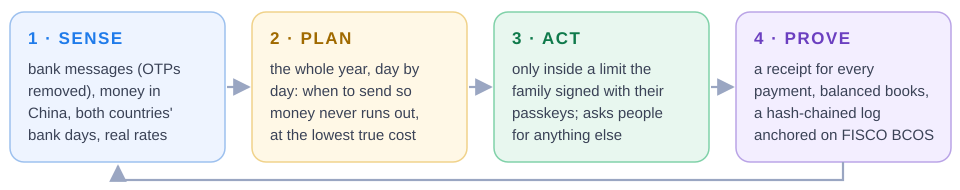
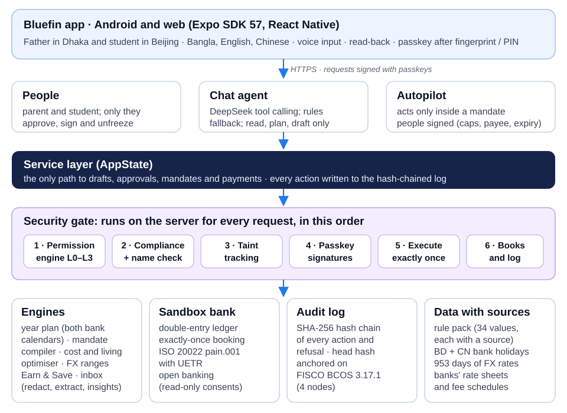
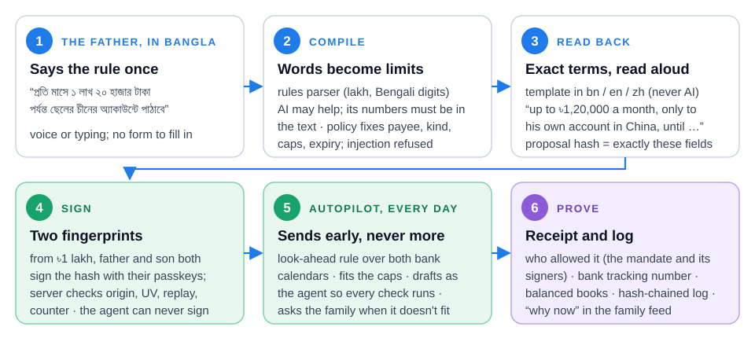
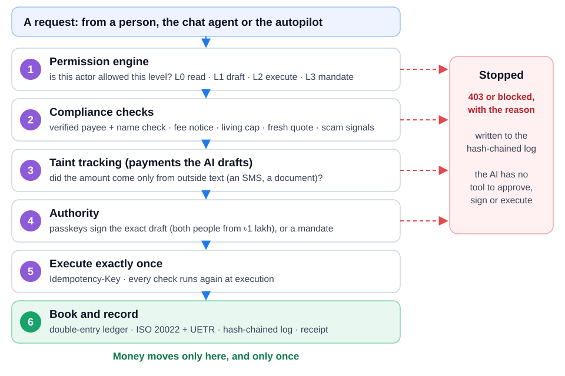
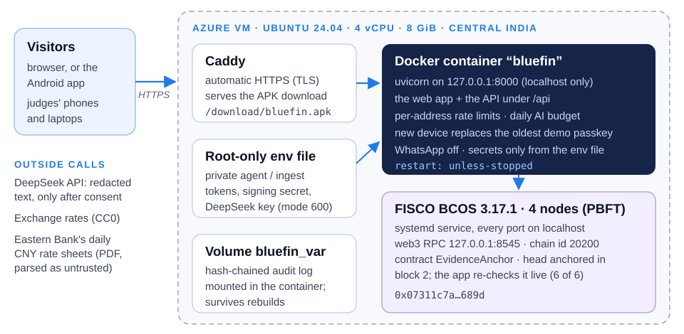

# Bluefin: Technical Documentation

**FinTechathon 2026 · International Track · Topic C: Cross-border & Student Finance Assistant**
Team inki_ponki · Repository: https://github.com/Tasrif-Ahmed-Mohsin/finbuddy · Live demo: https://20-193-145-135.sslip.io · Version: 19 Oct 2026
Companions: [SECURITY_SELF_ASSESSMENT.md](SECURITY_SELF_ASSESSMENT.md) · [EXECUTION_EVIDENCE.md](EXECUTION_EVIDENCE.md)

## At a glance

**Bluefin keeps an international student funded all year through the legal bank channel, and acts on its own only inside a limit the family has signed.** Our corridor is Bangladesh → China: a father in Dhaka pays, through his bank, for a son studying in Beijing. *Sandbox: no real money moves. The exchange rates (live plus 953 days), the banks' published rate sheets and 2026 fees, one real BRAC payment and the rules are real, each with its source and a confidence label.*

<div class="glance">
<div class="stat"><b>20 → 0</b><span>days without money in the student's year: today's habits vs Bluefin's plan, same banks, same rates</span></div>
<div class="stat"><b>64%</b><span>of 200 deliberately messy years still have no day without money (today's habits: 0%)</span></div>
<div class="stat"><b>5.5×</b><span>a real payment's fixed charge vs its exchange-rate markup: fees, not the rate, are the leak</span></div>
<div class="stat"><b>20 / 20</b><span>scripted judge tasks pass in fresh sandboxes (task 9, security 7, interaction 4)</span></div>
<div class="stat"><b>419</b><span>automated tests; 50,000 random honest and hostile steps with 0 safety rules broken</span></div>
<div class="stat"><b>6 / 6</b><span>live checks of the audit log's anchor on FISCO BCOS (challenge bonus)</span></div>
</div>



<div class="key">

**What this document covers.** The three items the rules ask for:

- **System architecture** (§2): layers, components, the loop end to end, a payment's life, the deployment.
- **Core algorithms** (§3): each with its problem, method, guarantees and evidence.
- **Security design** (§4): the full permission-tier implementation and the 40-item known-risk list are in the security self-assessment.

§1 gives the problem in one page. §5–8 cover data, measured value, deployment and testing. §9 lists limitations.

</div>

<div class="key">

**Check it yourself in two minutes.**

1. Open https://20-193-145-135.sslip.io (or the Android app at `/download/bluefin.apk`).
2. Go to Settings → **Judge mode** → *Run all tasks*: 20 of 20.
3. Go to Family → **Proof**: "Anchored on FISCO BCOS, 6 of 6 checks".
4. In the repository: `cd backend && python -m pytest -q` (419 tests), and `python scripts/verify_audit_log.py ../docs/evidence/sandbox_operation_log.jsonl`.

</div>

## 1. The problem and the product

<div class="key">

**Key points**
- Outbound money for study can only leave Bangladesh through a bank **Student File**. That legal channel breaks on **predictable days**: the card endorsement ends, and Eid and Spring Festival close banks.
- With today's habits, our student is without money on **20 days** of his year. On those days, someone offers **hundi**: illegal, no recourse, and it can freeze his Chinese account.
- **Fees, not the exchange rate, are the big loss:** 89% of what a family loses in a year is fees and surcharges.

</div>

**Why the legal channel is fragile.** Wise and Remitly cannot send outbound BDT (Wise's help page says so).

- **The card stops.** The student's card endorsement is short (September to December). Renewing it needs the student in person, with the passport (field interview), so a student in China loses card access abroad.
- **Card limits and costs.** Monthly caps of 5 lakh BDT and 30 transactions apply, and every ATM withdrawal costs about ৳345.
- **Slow transfers and closed banks.** A transfer takes about 7 days. Bangladeshi branches close Friday–Saturday and for about a week at each Eid; Chinese banks close for Spring Festival.

**The evidence.** We have 34 sourced problems ([01_problem_research.md](01_problem_research.md)), a field interview with a Bangladeshi student who arrived in China in September 2026 (with a follow-up on 13 Oct), and a second interview about part-time work:

- **Fees are the leak.** On the interviewee's real BRAC payment of ¥35,200 at ৳18.35, the rate was only **+0.22%** over the mid-market average (৳1,448). The fixed charge of about ৳8,000 was **5.5×** that. Over a year, fees and surcharges are **89%** of today's loss.
- **Both parent and student handle money,** in different languages. The university and the bank speak Chinese.
- **Scams and informal channels are real:** hundi was offered to the interviewee; there are "discount tuition agents" and fake-police calls.
- **When the dollar is short,** families use hundi ("1–2 taka lost per dollar"), while the student's own pay abroad leaks into wants (Interview #2).

**The product: one loop, not a list of features.**

| Step | What Bluefin does | In the app |
|---|---|---|
| **Sense** | Money in China and transfers on the way; bank SMS and email (one-time codes removed); photographed documents; the real exchange rate; a read-only bank connection | Home, Bluefin (chat) |
| **Plan** | The **"never stuck" year plan**: a day-by-day simulation across both countries' bank calendars, the card's end date and card limits; the true cost (rate markup vs fees) | Plan → Year |
| **Act** | The parent **says** a family mandate in their own words. It becomes a strict proposal, read back, then signed with passkeys after a fingerprint (both people for large caps). The **autopilot** sends living money inside it and asks for anything else | Family → Act |
| **Prove** | A receipt for every payment (who or what allowed it, with its bank tracking number), double-entry books, a hash-chained log anchored on FISCO BCOS, and a payment passport | Family → Proof |

| Organiser capability | How Bluefin shows it |
|---|---|
| **Intent understanding** | Mandates in Bengali, English or Chinese (rules parser plus grounded DeepSeek); chat with tool calling; SMS and email parsing; document photos |
| **Task planning** | Year plan with look-ahead top-ups; living-money optimiser; tuition send-by planner; renewal plan for a student abroad |
| **Safe execution** | Autopilot only inside a signed mandate (L3); every payment re-checked by deterministic rules; approvals bound to the exact draft; sandbox bank; hash-chained log |
| **User control** | Read-back (also aloud) before signing; signatures bound to the proposal hash; two people from ৳1 lakh; one-tap cancel; the family is asked whenever a limit would be exceeded |
| **Measurable value** | Stuck days **20 → 0**; **0** in a four-month live sandbox run; overhead **4.39% → 3.88%**; in a four-week dollar crisis, **0% → 39% → 94%** of start weeks without a stuck day (today → Bluefin → Bluefin + Shield) |

## 2. System architecture

<div class="key">

**Key points**
- **One server-side service layer** is the only path to drafts, approvals, mandates and payments. A **security gate** in front of it runs six checks in order, so neither a tampered app nor the AI can skip them.
- **Three kinds of requester:** people (who sign), the chat agent (which can only read, plan and draft) and the autopilot (which acts only inside a mandate people signed).
- **Everything is recorded** in double-entry books and a SHA-256 hash-chained log, whose head is anchored on FISCO BCOS.

</div>

### 2.1 Layers and components



<p class="cap">Figure 2 · Requests from the app reach the service layer through the security gate; engines, the sandbox bank, the audit log and the sourced data sit behind it.</p>

**Why a backend, not "all in the phone":** the permission checks, compliance rules, autopilot and audit log must run where neither a tampered app nor the AI can skip them. Every route goes through one service class (`backend/app/service.py`), and every action is logged.

| Component | Responsibility | Code |
|---|---|---|
| Mobile app | Five tabs (Home, Plan, Bluefin, Save, Family), Story mode, first launch, approvals, emergency, privacy, bank connections; passkeys; bn/en/zh (860+ strings each); lakh and Bengali digits | `mobile/src/` |
| Service layer | Plans, drafts, approvals, execution, mandates, year plan, feed, receipts, simulated time, cards, renewals, passport, documents | `backend/app/service.py` |
| Security | Permission levels and tokens, WebAuthn (ES256) verification, compliance checks, scam/injection patterns, taint tracking, output firewall, Confirmation of Payee, safety fuzzer | `backend/app/security/` |
| Agent | Tool-calling chat agent with a rules fallback, mandate compiler, autopilot, DeepSeek client, explanations | `backend/app/agent/` |
| Engines | Year plan, cost and cost truth, living optimiser, tuition planner, FX ranges, stress test, Earn & Save (income, savings rule, Shield), hundi comparison | `backend/app/engines/` |
| Sandbox bank | Double-entry ledger, exactly-once booking, transfers that leave on a Bangladeshi bank day and land on a Chinese one | `backend/app/sandbox/` |
| Integrations | ISO 20022 `pain.001` with UETR, read-only open-banking consents, WhatsApp family alerts (off on the public demo) | `backend/app/integrations/` |
| Inbox | Filter, redact, parse, AI fallback with number grounding, insights | `backend/app/inbox/` |
| Audit | SHA-256 hash-chained log; export and standalone verifier; FISCO BCOS anchor | `backend/app/audit/`, `backend/scripts/` |
| Data | Rule pack (`corridors/bd_cn.yaml`, every value with source and confidence), BD and CN bank holidays, FX history, bank rate sheets and fees | `backend/app/corridors/`, `backend/app/data/` |

### 2.2 The loop, end to end: the father's words → the autopilot



<p class="cap">Figure 3 · The father says the rule once. It is compiled, read back and signed by both people; afterwards the autopilot acts only inside it, and every payment leaves a receipt.</p>

1. **The father says the rule:** "প্রতি মাসে ১ লাখ ২০ হাজার টাকা পর্যন্ত ছেলের চীনের অ্যাকাউন্টে পাঠাবে" (up to ৳1,20,000 a month to my son's account in China).
2. **Compile.** The rules parser reads the number. DeepSeek may help, but its numbers must be ones the parser found. Policy fixes the payee (the son's own verified account), the kind (living money), the caps and the expiry.
3. **Read back.** A template in bn/en/zh, never AI text. The proposal hash covers exactly the fields shown.
4. **Sign.** From ৳1 lakh, both father and son sign that hash with their phone's passkey. The server verifies each signature: challenge = hash, origin, user verified, replay, counter.
5. **Every sandbox day, the autopilot:**
   - runs the look-ahead rule (§3.2) over both bank calendars;
   - fits the amount inside the caps;
   - drafts as the AI agent, so every compliance check runs;
   - executes at level MANDATE.

   When the cap is too small, it asks the family instead.
6. **Prove.** Each payment has a receipt naming the mandate and its signers, a bank tracking number (UETR), balanced books and log entries, and a "why now" line in the family feed.

### 2.3 A payment's life (tuition, judge task T1)



<p class="cap">Figure 4 · A request is stopped, with its reason logged, at the first layer it fails. Money moves only at the last step, and only once.</p>

1. **Plan.** The agent plans the tuition: ¥35,200 due 15 Nov. Banks are ranked by all-in cost, with a send-by date of 5 Nov.
2. **Draft.** The agent creates a draft (allowed at L1). Compliance checks run: verified payee and name check, fee notice, fresh quote, clean memo, valid Student File.
3. **The agent cannot pay.** It tries to execute and gets **403**; it can never execute.
4. **The father signs.** He hears the read-back and signs the draft hash with his passkey. The amount is at least ৳1 lakh, so the student must sign too.
5. **Execute once.** An `Idempotency-Key` makes a retry pay once, and every check runs again at execution.
6. **Book and record.** The payment is booked once in the double-entry ledger, with an ISO 20022 `pain.001` and its UETR. The transfer leaves on a Bangladeshi bank day and lands on a Chinese one, and is logged.

### 2.4 Deployment



<p class="cap">Figure 5 · One Azure VM: Caddy terminates HTTPS, the app listens on localhost only, secrets come from a root-only file, and a 4-node FISCO BCOS chain holds the evidence anchor.</p>

### 2.5 Repository map

| Path | Content |
|---|---|
| `backend/app/service.py` | The service layer (see §2.1) |
| `backend/app/engines/` | `year_plan.py`, `cost.py`, `cost_truth.py`, `living_planner.py`, `tuition_planner.py`, `fx_range.py`, `stress.py`, `rate_watch.py`, `earnings.py`, `hundi.py` |
| `backend/app/agent/` | `autopilot.py`, `mandate_compiler.py`, `chat.py`, `llm.py`, `explain.py` |
| `backend/app/security/` | `permissions.py`, `passkey.py`, `compliance.py`, `scam.py`, `taint.py`, `firewall.py`, `cop.py`, `fuzzer.py`, `mutants.py` |
| `backend/app/integrations/` | `iso20022.py`, `open_banking.py`, `whatsapp.py` |
| `backend/app/inbox/` | `filters.py`, `redact.py`, `parsers.py`, `extract_llm.py`, `insights.py`, `service.py`, `email_imap.py` |
| `backend/app/` | `notify.py`, `fx.py`, `market.py`, `bank_rates.py`, `renewal.py`, `passport.py`, `documents.py`, `emergency.py`, `privacy.py`, `judge.py`, `web.py` (public site), `sandbox/`, `audit/` |
| `backend/scripts/` | `fetch_fx_history.py`, `fetch_bank_rates.py`, `demo_scenario.py` (four-month run), `judge_tasks.py`, `fuzz_safety_invariants.py`, `verify_audit_log.py`, `anchor_fisco.py` |
| `backend/tests/` | 419 automated tests in 30 files (§8) |
| `mobile/src/` | Expo Router screens, components, API client, passkeys (`lib/passkey.ts`), i18n, formatting |
| `docs/` | Research, plans, this document, the security self-assessment, `evidence/` (operation logs and reports), `figures/` |

## 3. Core algorithms

<div class="key">

**Key points**
- **Deterministic engines decide every number.** The AI reads words, but its numbers must be found in the text.
- **The year plan and the live autopilot share one decision function**, so what the plan promises is what the agent does.
- **Every result is backtested or stress-tested** against real data, and the limits are said plainly.

</div>

### 3.1 The "never stuck" year plan (`engines/year_plan.py`)

<div class="algo">

**Problem.** Over the year, on which days would the student have no way to get money, and which transfer schedule avoids every one of them at the lowest cost?

**Method.** A day-by-day simulation, exact and explainable. The student spends `daily = monthly_living / 30` (¥200 for the demo). New money arrives two ways:

| Channel | Available when | Cost |
|---|---|---|
| ATM with the Bangladeshi card | only while the card endorsement is valid and the card is active, within the per-withdrawal, daily, monthly ATM, 30-transaction and 5-lakh caps | ৳345 + ¥25 per withdrawal, + 1% card markup, + 3% non-USD factor |
| Transfer (TT) from the Student File | sent only on a Bangladeshi bank day (not Friday or Saturday, not a BD holiday); lands after 7 days on the next Chinese bank day; Student File valid; ≤ USD 2,000 a month for living | cheapest bank's rate markup + its published fixed fees |

A **stuck day** is a day the student cannot cover their spending. The bank calendar (`data/bank_holidays.yaml`) lists closures in both countries, each with a confidence label: fixed-date holidays are `official`; lunar dates (Eid, Spring Festival) are `assumption` until published.

**Two strategies, same banks, same rate, no forecast:**
- **today:** a careful family now. They use the ATM while the card works (withdrawing when about 2 days are left). Once it stops, they send a transfer when about a week of money is left.
- **Bluefin** (`sathi` in the code): the look-ahead rule in §3.2, the same function the live autopilot uses.

**Result for the demo student** (saved real rates, 12 Oct 2026 → 29 Jun 2027):

| | Today's habits | Bluefin |
|---|---|---|
| Days without money | **20**, in 5 spells: after the card stops, Spring Festival, Eid-ul-Fitr, a weekend, Eid-ul-Azha | **0** |
| Fees + markup (published rates and fees) | ৳42,005 (**4.39%**) | ৳38,772 (**3.88%**) |
| Of which fees and surcharges | **89%** | 94% |
| Saved for the same money | | **৳5,126** |

**Guarantees and limits.**
- Each stuck spell lists its reason, for example "Banks were closed for Eid-ul-Fitr, which delayed the transfer."
- With real fees (৳3,680 per transfer at EBL), a transfer is fee-heavy and rate-light. Bluefin's value is mainly **no stuck days**; the saving comes from avoiding ATM fees and card surcharges.

</div>

### 3.2 The look-ahead top-up rule (`topup_decision`)

<div class="algo">

**Problem.** On each Bangladeshi bank day, should money be sent today, and how much?

**Method.** On a Bangladeshi bank day `d`, with balance `b` and transfers on the way:

```text
next       = next Bangladeshi bank day after d
wait_lands = Chinese bank day a transfer sent on `next` would land
if money never runs out before wait_lands
   and ≥ safety_days (5) of money are left the day before it lands
   and the same still holds if that transfer is 3 days late        # late margin
then  wait
else  send today:  lands = arrival(d)
                   amount = ceil₁₀₀(daily × (target + safety) − max(balance_at_landing, 0)),  ≥ ¥1,000
                   (target 30 days + safety 5 days)
if money runs out even before `lands`: tell the student the exact cash bridge (never withdraw cash itself)
daily = max(plan, the student's real pace over the last 14 days)  # spending pace; the biggest day ignored
```

**Guarantees.**
- Every decision carries its reason: the closures that make waiting unsafe (for example, "Eid closes BD branches 8–13 Mar, so a transfer sent on 14 Mar would land on 22 Mar"), or the day the money drops below the cushion.
- Unit tests cover waiting, sending before Eid with the right reason, the cash bridge, never sending on a bank holiday, the spending pace and the stress hooks.

</div>

### 3.3 Stress test and "what if" (`engines/stress.py`, `GET /plan/stress`)

<div class="algo">

**Problem.** Is "0 stuck days" robust, or one lucky simulation?

**Method.** The same year is re-run **200 times** (seeded, reproducible) with real-life mess:
- spending at 70–130% of the plan each month, plus 1–4 surprise bills a year (¥300–1,500);
- each transfer 0–3 days late;
- lunar holiday dates moved by −2…+2 days.

The planner never sees the future. It reacts to the real balance and the real spending pace, like the live autopilot. Both strategies face the same messy year in each run.

| 200 messy years | Today's habits | Bluefin |
|---|---|---|
| Years with no stuck day | **0%** | **64%** |
| Typical year (median) | 30 days | **0 days** |
| Mean / 90th percentile | 30.1 / 40 days | **0.9 / 3 days** |
| Worst year | 52 days | 10 days |

**What made it robust.** Both rules are shared with the live autopilot:

| Bluefin, 200 messy years | Years with none | Median | Mean | 90th pct | Worst |
|---|---|---|---|---|---|
| Plain look-ahead rule | 35.5% | 2 | 2.7 | 8 | 12 |
| + late margin only | 41% | 1 | 1.9 | 5 | 10 |
| + spending pace only | 53% | 0 | 1.4 | 5 | 10 |
| **+ both (shipped)** | **64%** | **0** | **0.9** | **3** | **10** |

**What if** (single scenarios, same year):

| Scenario | Stuck days: today → Bluefin | Family pays |
|---|---|---|
| The taka weakens 10% | 20 → **0** | +৳1.00 lakh for the year |
| The student spends 30% more | 38 → **0** | +৳3.14 lakh (more money sent; Bluefin notices within 1–2 weeks) |
| Every transfer is 3 days late | 23 → **0** | same |
| Eid and Spring Festival fall 2 days later | 20 → **0** | same |
| All of these at once | 45 → **0** (2 cash bridges while the card works) | +৳4.48 lakh |

**Remaining risk, said plainly.** The worst years have a late transfer running into a moved holiday after the card has stopped, so there is no fast cash channel. That is the emergency plan's job (§3.10), not scheduling's.

</div>

### 3.4 Family mandate compiler (`agent/mandate_compiler.py`)

<div class="algo">

**Problem.** Turn a parent's sentence, in any of three languages, into a strict, signable rule that the AI cannot widen.

**Method.**

1. **Rules parser** (offline, deterministic). It reads:
   - Bengali and full-width digits, and `1,20,000`;
   - compound amounts: `১ লাখ ২০ হাজার` = 120,000, `1.2 lakh`, `12万`;
   - "per month" and "per week";
   - "for N months", which is a duration, not money.

   It recognises tuition, other payees and limits in yuan, which are refused.
2. **DeepSeek** (optional, `json_object`) reads the same text. **Grounding:** every number it returns must be one the rules found, or it is ignored with a note. Only the rules may refuse; the model's flags become reminders.
3. **Policy validator:**
   - The payee is always the student's own verified Chinese account.
   - Living money only (`tt_living`, never tuition).
   - The cap is clamped to Bangladesh's living limit (USD 2,000 a month, about ৳2,53,000).
   - At most 12 months, and never past the Student File.
   - "Per month" means a calendar month.
   - A per-payment cap of ৳1 lakh or more needs **both parent and student**.
   - Scam or injection text is refused.
4. **Read-back** in bn/en/zh, from templates (never the LLM). The proposal **hash** covers exactly the fields shown: what you read is what you sign. The agent may propose, but never sign.

**Evidence.** `test_family_mandate.py` (28 tests); judge task T3 (125 days of autopilot); red-team rows on wrong hashes, agent signatures and injected instructions (security self-assessment §9).

</div>

### 3.5 Autopilot (`agent/autopilot.py`)

<div class="algo">

**Method.** It runs once per sandbox day, and right after a mandate is signed:

1. **Sense:** the money in China and the transfers on the way.
2. **Plan:** `topup_decision` (§3.2).
3. **Fit:** the largest ¥100 multiple whose cheapest all-in cost stays inside Bangladesh's monthly living limit and the mandate's per-payment and calendar-month caps.
4. **Act:** draft as the AGENT (all compliance checks run), then execute under the mandate at level MANDATE. If it does not fit, or a check fails, **ask the family** instead (one request per month and reason).
5. **Explain** in the family feed in three languages ("Why now: banks are closed for Eid-ul-Fitr…").

It warns 14 days before the mandate ends and before the card stops. **Reading an SMS never triggers a payment.**

</div>

### 3.6 All-in cost, cost truth and rate watch (`engines/cost.py`, `cost_truth.py`, `rate_watch.py`, `bank_rates.py`)

<div class="algo">

**Method.** All money uses `Decimal`. Each cost line is tagged `mid` (the money itself), `rate` (the exchange-rate markup) or `fee` (fixed fees and surcharges), so the app shows where the money goes.

```text
TT:   total = (X + intermediary) × bank_rate + fees(principal)
      fees  = (commission(principal) + correspondent ৳2,500 + SWIFT ৳500) × 1.15 VAT
ATM:  (wᵢ + CN_fee) × mid × (1 + card_markup) × (1 + non_USD_factor) + BD_fee
```

**Where prices come from.**

- **Rates:** Eastern Bank's own daily CNY sheets (`published`), then a real payment, a user's quote, and only then an estimate.
- **Fees:** the banks' published schedules of charges, with commission by value sent (৳100–500), correspondent bank ৳2,500, SWIFT ৳500 and 15% VAT. A ৳1,13,000 transfer pays **৳3,680** at EBL.
- **No guessing:** a bank whose fees are not published is not priced.

The sheet fetcher treats downloaded PDFs as **untrusted**: magic bytes are checked, files must be ≤ 2 MB and ≤ 5 pages, and they are parsed in memory. Each row is sanity-checked (buying < mid < selling, spread < 5%). A changed layout is rejected, not guessed.

**Cost truth.** The real payment, recomputed from saved market data:

| Item | Amount |
|---|---|
| Rate markup (৳18.35 paid vs ৳18.31 mid, 15 Aug–30 Sep) | **৳1,448 (0.22%)** |
| Fixed charge | **৳8,000**, matching the banks' published one-time Student File opening fees (৳6,900–8,625) |
| Charge vs markup | **5.5×** |
| Paid in total | ৳6,53,920 |

**Rate watch: does timing the bank pay?** Over 138 of Eastern Bank's published sheets, the markup over the market had a median of 0.97% (range 0.28–1.52%). The usual rule, "today looks expensive, so wait up to 3 sheets", saved **0.02% on average (৳21 per lakh)**, against ৳3,565 in fees per transfer. So Bluefin does **not** time the market. It avoids extra transfers and days without money, and shows this finding to families.

</div>

### 3.7 Living-money optimiser and tuition planner (`engines/living_planner.py`, `tuition_planner.py`)

<div class="algo">

**Living-money optimiser.** An exact grid search over the transfer amount (¥100 steps); the rest goes to ATM withdrawals of maximum size in whole ¥100 notes. Every option must stay within:
- 30 card transactions and ৳5 lakh a month;
- the ATM caps;
- the USD 2,000 a month living cap;
- a cash bridge for the days before a transfer can land.

Every rejected option records the limit it breaks. A 30-combination property test checks that the plan **never breaks a limit**. ¥6,000 a month saves ৳3,001 against ATM only.

**Tuition planner.**
- **Send-by date** = deadline − 7 transfer days − 3 buffer days. Chinese universities count a fee as paid on arrival.
- **Banks** are ranked by all-in cost for the exact amount.
- **Wait-risk** is shown as a range, labelled honestly: waiting has no expected gain.

**FX ranges with an honesty check** (`engines/fx_range.py`). No direction is predicted (Meese & Rogoff 1983). The ranges are empirical 10th/50th/90th percentiles of past h-day log returns. A backtest on 953 real days found 7-day 80% ranges right **81.9%** of 689 times.

</div>

### 3.8 Message pipeline and chat agent (`inbox/`, `agent/chat.py`)

<div class="algo">

**Message pipeline.**

```text
filter → redact (one-time codes removed, numbers masked) → scam/injection scan → rules extraction
→ DeepSeek fallback on redacted text, with number grounding → card-limit tracking → deterministic insights
```

The insights cover ATM-fee leakage, card limits at 80% or more, large debits ("was this you?" plus freeze), duplicate charges, phishing, one-time codes received, renewal steps and hidden FX markups.

**Chat agent.** DeepSeek `deepseek-flash`, thinking off, at most 4 tool rounds.
- **Tools:** `get_overview`, `get_updates`, `list_transactions`, `compare_tuition`, `plan_living`, `get_year_plan`, `check_message`, `start_renewal`, `freeze_card`, `propose_mandate`, `create_payment_draft`.
- **Missing on purpose:** there is **no tool to approve, execute, sign, unfreeze or change a mandate**. Every tool runs as `Actor.AGENT` through the permission engine.
- **Fallback:** a deterministic router in bn/en/zh answers when the AI is off or down.
- **What every turn returns:** `signals` (refused, clarify, corrected, drafted, cancelled, checked, card_locked, offline) and one-tap `choices`.

</div>

### 3.9 Earn & Save: the student's own money (`engines/earnings.py`, `hundi.py`, `stress.dollar_crisis`)

<div class="algo">

**Problem** (Interview #2). When the dollar is short, money cannot come from home legally, and families use hundi. Meanwhile, the student's own pay abroad leaks into wants.

**Idea.** The cheapest, safest yuan is the one that never crosses the border. Bluefin turns part of the student's own pay into a **Shield**: a pocket of the student's own Chinese account for the days the legal channel is closed.

- **Work rules.** Only income allowed by the rules counts: university approval (Exit and Entry Administration Law Art. 43; fines under Art. 80) and a weekly hour cap. An unapproved job is flagged, never planned on and never simulated.
- **Savings rule** (rules-only parsing, in three languages). It takes 5–80% of each pay, up to a target of ¥500–100,000, with a cooling-off of 0, 24 or 72 hours.
  - The rule's hash fixes the destination (`student_shield`), so no wording can redirect it.
  - **Only the student signs**; the agent and the parent get 403.
- **Saving:** `keep = min(floor(pay × pct / 100), target − shield)`. The Shield is excluded from the money the plan counts, so savings never shrink the family's transfers.
- **Taking money out:**
  - When money in China cannot cover today, the Shield covers it at once (L3, inside the rule).
  - Anything else waits the cooling-off, plus the parent's approval if the student chose a family lock.
  - Money only ever moves between the student's own pockets.
- **Taka lens** and an **honest hundi check** show the same money every way, including when one bank transfer costs more on paper. Bluefin never suggests hundi.

| 4-week dollar crisis, 33 start weeks | Today's habits | Bluefin alone | Bluefin + Shield (50% of pay) |
|---|---|---|---|
| Starts with no day without money | 0% | 39% | **94%** |
| Typical start (median) | 20 days | 4 days | **0 days** |
| Worst start (4 Jan 2027, right after the card stops) | 50 days | 25 days | **11 days** |

</div>

### 3.10 Emergency mode, renewals and the payment passport

<div class="algo">

**Emergency mode** (`emergency.py`, the red button on Home). The fastest *safe* way through; nothing moves without a fingerprint or the signed mandate.

- **No money now.** Every way money can reach the student is listed, soonest first, with dates from both bank calendars. "Ask my family" runs the autopilot first, otherwise it prepares **one** urgent draft for the parent.
- **Card lost.** The card is frozen first, then the plan is redone without it.
- **Fake police, courier or embassy calls.** A five-step guide in bn/en/zh.
- **"Your child was arrested" (to the parent).** An **"Are you safe?"** check that only the student can answer. The parent and the AI get 403.

**Renewals** (`renewal.py`).
- The Student File is scheduled backwards from its expiry.
- For the card endorsement (the renewal needs the student in person), living money switches to transfers before the card stops.

**Payment passport.** An HMAC-signed record of on-time payments, built from audit-log entries. It is revocable, expires after 90 days, and its public QR page needs a verification code. It is not an official credit score.

</div>

## 4. Security design

<div class="key">

**Key points**
- **The AI can prepare anything and authorise nothing.** Money moves only with people's passkey signatures over the exact payment, or inside a standing rule people signed.
- **Every check runs on the server**, in a fixed order (Figure 4), and a failure is logged with its reason.
- **The full permission-tier implementation, threat model, red-team results and the 40-item known-risk list** are in [SECURITY_SELF_ASSESSMENT.md](SECURITY_SELF_ASSESSMENT.md).

</div>


<p class="cap">Figure 6 · The AI agent may read and draft. Only people can approve a payment (L2) or sign a standing rule (L3), and nobody can override a hard block.</p>

- **Signatures are bound to what people saw.**
  - Mandates are signed over the proposal hash, payments over the draft hash.
  - The read-back is generated from those exact fields by a template, and can be heard aloud.
- **Passkeys (WebAuthn, ES256).** Before an approval counts, the server checks:
  - challenge = the object's hash, the origin and `rpIdHash`;
  - User Present and **User Verified**;
  - the signature, replay and the counter.

  A plain approval is refused. No private key exists in the code or on the server.
- **Two-person rule** for payments of ৳1 lakh or more, and for mandates whose per-payment cap is ৳1 lakh or more.
- **Asymmetric friction.** The agent may freeze a card and propose. It may not unfreeze, approve, sign or widen a limit. Either person can cancel a mandate in one tap.
- **AI containment:**
  - numbers grounded in the source text;
  - **taint tracking** on every amount from outside text (after DeepMind's CaMeL);
  - an **output firewall** on every reply (one-time codes, card and account numbers, the other person's private money, the system prompt);
  - a rules fallback when the AI is off or down;
  - the AI is used only after each person says yes (PIPL), asked on first launch with nothing pre-selected.
- **Integrity.** A SHA-256 hash-chained log of every action and refusal, verifiable without our server. Its head is anchored on FISCO BCOS (Figure 7).


<p class="cap">Figure 7 · Editing any entry breaks the chain at that entry; rewriting the whole log changes the head, which no longer matches the hash recorded on chain.</p>

**Bank-grade engineering.** Each piece is small, standard in banking, and tested:

| Piece | What it is | Code | Evidence |
|---|---|---|---|
| Passkey-signed approvals | WebAuthn (ES256) over the draft, proposal or consent hash; web: platform passkeys, or a labelled sandbox demo key when the device has no fingerprint, face or PIN; phone: a device key in secure storage after fingerprint or PIN | `security/passkey.py`, `mobile/src/lib/passkey.ts` | `test_passkey.py` (14), judge T1, S3 |
| Double-entry books | Every movement is a journal entry whose legs sum to zero per currency; trial balance and reconciliation checked | `sandbox/ledger.py` | `test_ledger.py`, `GET /ledger` |
| Exactly-once payments | `Idempotency-Key` on create, approve and execute; the bank never books one draft twice | `service.idempotent` | judge S7 |
| ISO 20022 + UETR | `pain.001.001.09` for every transfer: UETR, purpose `EDUC`/`FAMI`, charge bearer, Bangladesh Bank reporting; rule checks from the schema | `integrations/iso20022.py` | `test_iso20022.py`, Appendix B |
| Open banking (read-only) | Account information consents of at most 90 days, signed with a passkey; every read logged; nothing can move money (connectors simulated) | `integrations/open_banking.py` | judge T9 |
| Taint tracking | An amount the AI drafts that came only from outside text is refused, however it is phrased | `security/taint.py` | [taint_tracking_evidence.md](evidence/taint_tracking_evidence.md) |
| Confirmation of Payee | The receiving account's name is checked against who should hold it | `security/cop.py` | `test_cop.py` |
| Output firewall | Every reply is checked before display, in the reader's language | `security/firewall.py` | [ai_output_firewall_evidence.md](evidence/ai_output_firewall_evidence.md) |
| Safety-invariant fuzzing | 50,000 random honest and hostile steps, 9 invariants after each; 0 violations; 3 of 3 planted bugs caught | `security/fuzzer.py` | [safety_fuzzing_evidence.md](evidence/safety_fuzzing_evidence.md) |
| Your data (PIPL) | What is kept and why; copy and delete; a per-person AI choice (not asked means off) | `privacy.py` | `test_open_banking_privacy.py` |

**Review on 18 Oct (said honestly).** A first version of several of these overclaimed. The review fixed each one before submission:
- the passkey demo keys were fixed numbers in the app bundle;
- taint tracking blocked people's own payments;
- the firewall hid years;
- the ISO message used values the schema rejects;
- the security status endpoints were open.

## 5. Data, sources and licences

| Data | Source | Confidence / licence |
|---|---|---|
| Mid-market BDT/CNY (live + 953 days) | fawazahmed0/exchange-api | CC0-1.0 |
| Bank rates | Eastern Bank's published daily CNY sheets (`scripts/fetch_bank_rates.py`) and one real BRAC payment | published (indicative) / field |
| Bank fees | `bank_fees.yaml`: EBL (1 Jul 2026), Southeast Bank (1 Jan 2026), Prime Bank (Jul–Dec 2026) schedules | official / secondary; BRAC = assumption |
| Rules and limits | `corridors/bd_cn.yaml`, 34 values, each with its source | official / secondary / field / assumption |
| Bank holidays | `data/bank_holidays.yaml`, BD + CN, Oct 2026 – Sep 2027 | official (fixed) / assumption (lunar) |
| Student work rules (China) | Exit and Entry Administration Law Art. 43 / 80; student guides for the hour cap | official / secondary |
| Demo messages | `data/demo_messages.yaml` | **synthetic**, written by us |
| Behavioural research (Shield, taka lens) | Raghubir & Srivastava 2002; Prelec & Simester 2001; Ashraf, Karlan & Yin 2006; Thaler & Benartzi 2004 | peer-reviewed |

**Software licences** (all permissive): FastAPI, Pydantic, PyYAML, pytest (MIT); Uvicorn, NumPy, httpx, qrcode, pypdf (BSD); Expo, React Native and Expo modules (MIT); FISCO BCOS (Apache-2.0). Bank rate sheets and schedules of charges are public documents; we store only the numbers we use, with their source.

## 6. Measurable value

| Metric | Value | How measured |
|---|---|---|
| Days without money (year) | **20 → 0** | year plan, same banks and rates (§3.1) |
| Robustness | **64%** of 200 messy years with none (today: 0%); typical year **0** (today: 30) | stress test (§3.3) |
| What if | **0** stuck days with the taka 10% weaker, 30% more spending, transfers 3 days late, holidays moved, or all at once | §3.3 |
| Days without money (live) | **0** from 12 Oct 2026 to 21 Feb 2027, through the card stop and Spring Festival | four-month sandbox run |
| Overhead for the year | **4.39% → 3.88%** (৳5,126 saved for the same money) | year plan |
| Where money is lost | fees are **89%** of today's loss; the real charge was **5.5×** its rate markup | cost truth (§3.6) |
| Timing the bank | **0.02%** average gain from waiting, against ৳3,565 in fees per transfer | rate-watch backtest |
| Living money ¥6,000 a month | **৳3,001** saved a month against ATM only | optimiser (§3.7) |
| Dollar crisis (4 weeks) | starts without a stuck day **0% → 39% → 94%** | §3.9 |
| FX honesty | 7-day 80% ranges right **81.9%** of 689 tests | backtest (§3.7) |
| Safety | every red-team case blocked; **0** violations in 50,000 fuzz steps | tests, fuzzer |

## 7. Deployment and operations

**Live now: https://20-193-145-135.sslip.io** (Figure 5) runs on an Azure VM (Ubuntu 24.04, 4 vCPU, 8 GiB, Central India):
- the Docker image behind Caddy (automatic HTTPS), with the app on localhost only;
- private API tokens and signing secrets in a root-only environment file;
- a 4-node FISCO BCOS 3.17.1 chain for the evidence anchor, as a system service.

The Android app is at `/download/bluefin.apk`.

**Protections for a public demo.** Anyone can open it, and AI calls cost money:
- **Per-address rate limits:** AI-backed writes 20 per 10 minutes; other writes 120 per 10 minutes; the CPU-heavy stress test, judge run and fuzzing 30 per 10 minutes (and at most 200 runs a call).
- **AI budget:** a daily allowance (`SATHI_LLM_DAILY_CALLS`, 600). Past it, the rule-based fallback answers.
- **Messaging and secrets:** WhatsApp is off, and secrets come only from the host's environment.
- **Shared demo passkeys:** every visitor's device registers keys for the same two demo people, so a new device replaces that person's oldest key (logged as `passkey_replaced`; `SATHI_PASSKEY_REPLACE_OLDEST=1`) instead of being refused at five keys. Verified live on 19 Oct with seven fresh devices.
- **Reset:** "Start the demo again" (Settings) gives a clean sandbox from 12 Oct 2026.

**Run it yourself.**

```bash
# Backend (Python 3.12)
cd backend && python -m venv .venv && .venv/Scripts/python -m pip install -r requirements.txt
.venv/Scripts/python -m uvicorn app.main:app --host 0.0.0.0 --port 8000
# Mobile (Node 22): scan the QR code with Expo Go, or press w for the web
cd mobile && npm install && npx expo start
# Or the whole public site in one container
docker build -t bluefin . && docker run -p 8000:8000 -e DEEPSEEK_API_KEY=... bluefin
```

| Variable (`backend/.env`, git-ignored) | Purpose |
|---|---|
| `DEEPSEEK_API_KEY`, `DEEPSEEK_MODEL` | AI features (optional: the rules work without it); default model `deepseek-flash` |
| `SATHI_FX_MODE` | `live` (default) · `offline` (saved history) · `fixture` (tests) |
| `SATHI_INGEST_TOKEN`, `SATHI_PASSPORT_SECRET` | SMS-forwarder webhook secret; passport signing key |
| `SATHI_AGENT_TOKEN`, `SATHI_PARENT_TOKEN`, `SATHI_STUDENT_TOKEN` | private role tokens on a public server (demo tokens otherwise) |
| `SATHI_LLM_DAILY_CALLS`, `WHATSAPP_MODE` | AI budget; `off` / `dry_run` / `live` |
| `SATHI_PASSKEY_REPLACE_OLDEST` | `1` on the shared public demo only |
| `EXPO_PUBLIC_API_URL` (mobile) | backend address (`/api` when served together) |

**Final-day network plan (Shenzhen).** DeepSeek is reachable from mainland China. If the network fails anyway, FX switches to the saved history, mandates compile with the rules parser and the agent uses its fallback, so every task still completes.

## 8. Testing

<div class="key">

**Key points**
- **419 automated tests in 30 files, all passing.** They include every red-team case in the security self-assessment. Tests never call the real AI or the network (a fake DeepSeek server is used).
- **Judge mode** runs the brief's 20 scripted tasks through the real API, each in a fresh sandbox: 20 of 20, also on the live server.
- **Safety fuzzing:** 50,000 steps, 0 violations, 3 of 3 planted bugs caught.

</div>

| Area | File | Tests |
|---|---|---|
| Earn & Save: work rules, savings rule, Shield, cooling-off, privacy, taka lens, hundi, dollar crisis | `test_earn_save.py` | 40 |
| Living optimiser (incl. the 30-combination limit check) | `test_living_planner.py` | 36 |
| Dialogue: clarification, correction, refusal, quick replies (EN/BN/ZH) | `test_dialogue.py` | 33 |
| Family mandate, signatures and autopilot | `test_family_mandate.py` | 28 |
| Bank prices: published sheets, fee schedules, rate watch | `test_bank_prices.py` | 23 |
| Emergency mode, fake emergencies, "Are you safe?" | `test_emergency.py` | 22 |
| Security and permissions (red team) | `test_security.py` | 21 |
| Inbox and message privacy | `test_inbox.py` | 17 |
| FX and card controls | `test_fx_and_cards.py` | 16 |
| Output firewall | `test_firewall.py` | 15 |
| End-to-end API scenarios | `test_api_scenarios.py` | 15 |
| Passkeys: replay, wrong payment, phishing origin, two people, the shared-demo key limit | `test_passkey.py` | 14 |
| Year plan, bank calendar, cost truth | `test_year_plan.py` | 12 |
| Stress test, what-if, spending pace, late margin | `test_stress.py` | 12 |
| WhatsApp alerts (dry run) | `test_whatsapp.py` | 10 |
| Renewals (incl. endorsement from abroad) | `test_renewal.py` | 10 |
| Payment passport | `test_passport.py` | 10 |
| Public deployment: routing, path traversal, rate limits, AI budget, reset | `test_web.py` | 9 |
| Agent (tool calling, fake model) | `test_agent.py` | 9 |
| On-chain anchor: live checks, an edited log, a foreign transaction, an unreachable chain | `test_chain_anchor.py` | 8 |
| Bank connections and your data (PIPL), AI consent | `test_open_banking_privacy.py` | 8 |
| ISO 20022 and UETR | `test_iso20022.py` | 8 |
| Taint tracking | `test_taint.py` | 7 |
| Double-entry books and exactly-once | `test_ledger.py` | 7 |
| Judge mode: 20 tasks, compromised-AI drill, no real messages, private tokens | `test_judge.py` | 5 |
| Tuition and FX method | `test_tuition_and_fx.py` | 5 |
| Safety fuzzer and its mutants | `test_fuzzer.py` | 5 |
| Documents | `test_documents.py` | 5 |
| Confirmation of Payee | `test_cop.py` | 5 |
| Cost engine | `test_cost.py` | 4 |
| **Total** | **30 files** | **419** |

The mobile app type-checks and lints clean (`npx tsc --noEmit`, `npx expo lint`). The execution evidence (four-month run, log, judge tasks, fuzzing) is described in [EXECUTION_EVIDENCE.md](EXECUTION_EVIDENCE.md).

## 9. Limitations and next steps

- **Sandbox only.** Real execution would go through licensed banks: the autopilot would submit Student File transfer requests through a bank API, or prepare a branch-ready request.
- **Bank prices.**
  - Only one bank publishes daily CNY rates we can read (EBL), and the sheets are "indicative". BRAC's schedule of charges was not found online.
  - Next: more banks' sheets, real debit advices from students, and consented, anonymous "true-cost" contributions.
- **Lunar holiday dates are estimates** until the governments publish them, and China's make-up working Saturdays are not modelled.
- **Stress-test ranges are assumptions**, chosen to be pessimistic, and are not yet measured from data. Spending in the live sandbox is constant; in production the pace would come from parsed bank alerts.
- **On-chain anchoring is one chain run by us.** Next: anchor each day's head automatically on a consortium FISCO BCOS chain whose nodes are run by independent parties, such as the partner banks.
- **Earn & Save.** Income is declared, not verified with an employer, and China's weekly hour cap comes from conflicting secondary sources (Bluefin warns at the stricter one). In production, the Shield would be a real sub-account at the student's Chinese bank.
- **Production hardening** is listed in the security report:
  - real authentication and identity proofing before a new passkey;
  - platform passkeys with attestation;
  - the official ISO 20022 XSD;
  - a durable idempotency store;
  - KMS.

## Appendix A · API overview (FastAPI; interactive docs at `/docs`)

| Area | Endpoints |
|---|---|
| **Loop** | `GET /plan/year`, `GET /plan/stress?runs=`, `GET /runway`, `GET /feed?lang=`, `GET /receipts`, `POST /sandbox/advance`, `GET /calendar/week`, `GET /value` |
| **Judge mode** | `POST /judge/run`: every scripted task end to end in fresh sandboxes, with steps, checks, value and log evidence |
| **Family mandate** | `POST /mandates/proposals`, `GET /mandates/proposals/{id}`, `POST /mandates/proposals/{id}/sign` (`proposal_hash` + passkey `assertion`), `GET /mandates`, `DELETE /mandates/{id}` |
| Rates and plans | `GET /market`, `POST /market/quotes`, `GET /fx`, `GET /fx/history`, `POST /plan/tuition`, `POST /plan/living` |
| Drafts and execution | `POST /drafts`, `GET /drafts[/{id}]`, `POST /drafts/{id}/passkey-approve`, `POST /drafts/{id}/execute`, `POST /drafts/{id}/execute-under-mandate/{m}`; writes accept an `Idempotency-Key` |
| **Passkeys** | `GET /auth/passkey/credentials`, `POST /auth/passkey/register` (public key only), `DELETE /auth/passkey/credentials/{id}` |
| **Books** | `GET /ledger` (trial balance, reconciliation, entries) |
| **Bank connections** | `GET /banks`, `POST /banks/consents`, `POST /banks/consents/{id}/authorise` (passkey), `DELETE /banks/consents/{id}`, `GET /banks/{connector}/accounts` |
| **Your data** | `GET /privacy`, `GET /privacy/export`, `POST /privacy/delete`, `POST /privacy/ai` |
| **Security evidence** | `GET /security/anchor` (FISCO BCOS, checked live), `GET /security/fuzz-results`, `POST /security/fuzz/run`, `GET /security/taint/status`, `GET /security/firewall/status`, `POST /security/cop/verify`, `GET /receipts/{id}/pain001.xml` |
| Agent and inbox | `POST /agent/chat`, `GET /agent/status`, `POST /check/message`, `POST /inbox/messages`, `POST /inbox/webhook`, `POST /inbox/demo/seed`, `GET /insights?lang=` |
| **Emergency** | `GET /emergency?lang=`, `POST /emergency/no-money`, `POST /emergency/card-lost`, `POST /emergency/safety-checks` (parent), `POST /emergency/safe` (student only) |
| **Earn & Save** | `GET /save?lang=`, `POST /save/income/sources`, `POST /save/income`, `POST /save/spend`, `POST /save/rule/proposals`, `POST /save/rule/proposals/{id}/sign` (student only), `POST /save/shield/release`, `POST /save/hundi-check`, `GET /save/crisis?weeks=` |
| Overview | `GET /timeline`, `GET /profile`, `GET /accounts`, `GET /corridor`, `GET /audit`, `GET /audit/export`, `GET /health` |

Authentication in the sandbox uses role bearer tokens (`demo-student`, `demo-parent`, `demo-agent` locally; private tokens on the public server), a known risk (R1 in the security report).
