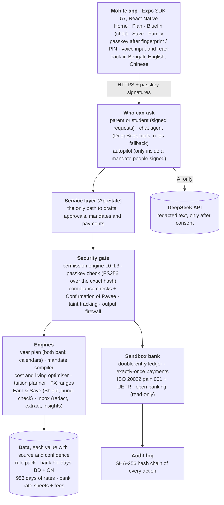
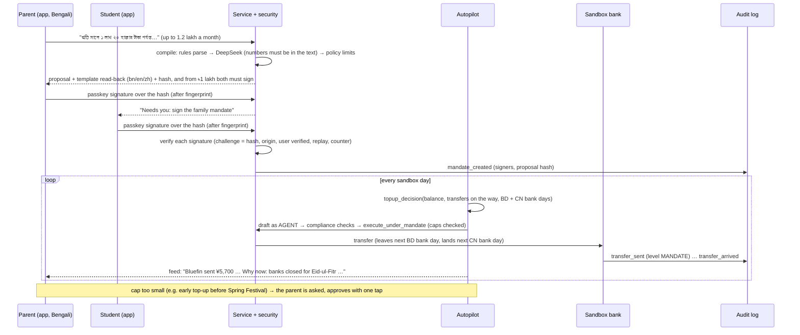
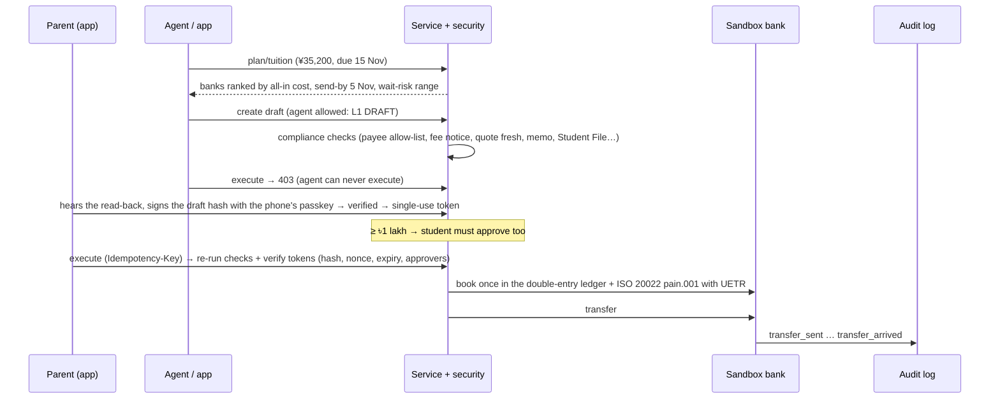
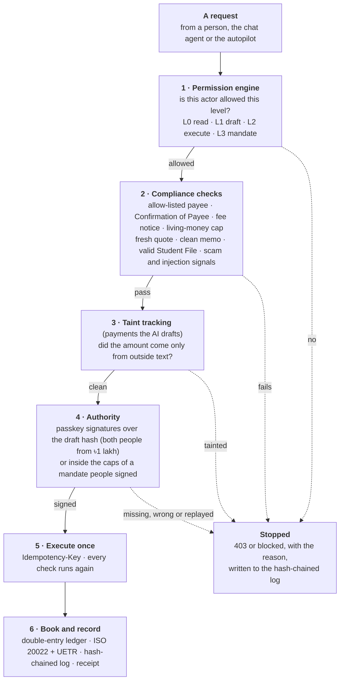

# Bluefin: Technical Documentation

**FinTechathon 2026 · International Track · Topic C: Cross-border & Student Finance Assistant**
Team inki_ponki · Repository: https://github.com/Tasrif-Ahmed-Mohsin/finbuddy · Version: 18 Oct 2026
Companions: [SECURITY_SELF_ASSESSMENT.md](SECURITY_SELF_ASSESSMENT.md) · [EXECUTION_EVIDENCE.md](EXECUTION_EVIDENCE.md)

**What this document covers** (the three items the rules ask for): the **system architecture** (§3), the **core algorithms** (§4) and the **security design** (§5, with the full permission-tier implementation and known-risk list in the security self-assessment). §1–2 give the problem and the product in one page; §6–11 give data, measured value, the API, deployment, tests and limitations.

> **Sandbox:** no real money moves. All payments run in a simulated bank. The **exchange rate is real** (live, plus 953 days of saved daily history). **Bank prices are real or published**:
> - Eastern Bank's own daily CNY rate sheets (`bank_rates.csv`, refreshed automatically).
> - Fees from banks' published 2026 schedules of charges.
> - One real payment (BRAC Bank, ৳18.35/¥).
>
> The few parts that are not published are labelled as assumptions. Every rule, fee and holiday date carries its source and a confidence label.

---

## 1. Summary

**Bluefin keeps an international student funded all year through the legal bank channel, and acts on its own only inside a limit the family has signed.** The hero corridor is **Bangladesh → China**: parent and student both handle money (field interview), the parent pays from Dhaka in Bengali, the student lives in China, and university and bank documents are in Chinese.

**Why this matters.** Money leaving Bangladesh for study can only go through a bank **Student File**: there is no Wise or Remitly for outbound BDT (Wise's own help page says it cannot send from BDT). That legal channel is fragile:

- the student's **card endorsement** is short (Sep → Dec), and **renewing it needs the student in person** at the bank with the passport (field interview), so a student in China loses card access abroad;
- monthly card caps (5 lakh BDT / 30 transactions) apply, and every ATM withdrawal costs ~৳345;
- transfers take ~7 days, Bangladeshi branches close Fri–Sat and for about a week at each Eid, and Chinese banks close for Spring Festival.

When the channel breaks, families are pushed toward hundi, and in China, money from strangers can get the student's account frozen. Bluefin's goal: **make the legal way easier than hundi.**

**One loop, not a list of features:**

| Step | What Bluefin does | Where |
|---|---|---|
| **Sense** | Money in China and transfers on the way; bank SMS/email (redacted); photographed documents; the real exchange rate; a read-only bank connection | Home, Bluefin (chat) |
| **Plan** | The **"never stuck" year plan**: a day-by-day simulation across both countries' bank calendars, the endorsement end and card limits; true cost (rate markup vs fees) | Plan → Year |
| **Act** | The parent writes or **says** a **family mandate** in their own words → strict proposal → signed with the phone's passkey after a fingerprint (both people for large caps) → the **autopilot** sends living money inside it and asks for anything else | Family → Act |
| **Prove** | A receipt for every payment (who or what authorised it) with its bank tracking number, double-entry books, a hash-chained log, the payment passport | Family → Proof (trust center) |

**Earn & Save (Interview #2, §4.14):** the second interviewee works part-time abroad. When the dollar is short the family uses hundi ("1–2 taka lost per dollar"), while the student's own pay leaks into wants. Bluefin treats the student's income as what it is, money that **never has to cross the border**, and turns part of it into a **Shield**: a savings rule the student signs keeps a share of each pay in their own Chinese account; emergencies use it at once; anything else waits a cooling-off. The same loop runs on it (Sense: income and wants in taka; Plan: dollar-crisis test, hundi check; Act: the autopilot inside the student's rule; Prove: every move in the log), in the **Save** tab.

| Organiser capability | How Bluefin shows it |
|---|---|
| **Intent understanding** | Mandates written in Bengali, English or Chinese (rules parser + grounded DeepSeek); chat with tool calling; SMS/email parsing; document photos |
| **Task planning** | Year plan with look-ahead top-ups; living optimiser; tuition send-by planner; renewal plan for a student abroad |
| **Safe execution** | Autopilot only inside a signed mandate (L3); every payment re-checked by deterministic compliance rules; approval tokens bound to the exact draft; sandbox bank; hash-chained log |
| **User control** | Read-back read aloud before signing or approving; signatures bound to the proposal hash; two-person rule from ৳1 lakh; one-tap cancel; the family is asked whenever a limit would be exceeded |
| **Measurable value** | Stuck days: **20 → 0** in the year plan, **0** in a 4-month live sandbox run; overhead **4.39% → 3.88%** with published bank fees; the real payment's fee was **5.5×** its rate markup; in a 4-week dollar crisis, **0% → 39% → 94%** of start weeks without a day without money (today → Bluefin → Bluefin + Shield) |

## 2. Problem and evidence (short)

Full research: [01_problem_research.md](01_problem_research.md) (34 problems with sources) plus a field interview with a Bangladeshi student who arrived in China in Sept 2026 (and a follow-up on 13 Oct). Key facts:

- **Fees, not the rate, are the big leak.** The interviewee's real BRAC payment of ¥35,200 at ৳18.35 was only **+0.22%** over the mid-market average for Aug–Sep (৳1,448). The **~৳8,000 charge was 5.5× that**. In the year plan, **70%** of what a family loses today is fees and surcharges, not the exchange rate.
- **The channel breaks on predictable days:** the endorsement ends on 31 Dec and cannot be renewed from China; Bangladeshi banks close Fri–Sat and for Eid; Chinese banks close for Spring Festival. With today's habits the demo student is without money on **20 days** of the year.
- **Both parent and student handle money** (follow-up), in different languages; the university and bank speak Chinese.
- **Scams and informal channels:** hundi was offered to the interviewee; "discount tuition agents"; fake-police calls.

## 3. Architecture



**Why a backend, not "all in the phone":** the permission checks, compliance rules, the autopilot and the audit log must run where neither a tampered app nor the AI can skip them. Every route goes through one service class (`backend/app/service.py`), and every action is logged.

### 3.1 The loop, end to end: family mandate → autopilot



### 3.2 Request lifecycle: tuition payment (task T1)



### 3.3 Repository map

| Path | Content |
|---|---|
| `backend/app/service.py` | Service layer: plans, drafts, approvals, execution, mandates and proposals, year plan, feed, receipts, simulated time, cards, renewals, passport, documents |
| `backend/app/engines/` | `year_plan.py` (calendar, look-ahead rule, simulation incl. income, Shield and a crisis window), `cost.py`, `cost_truth.py`, `living_planner.py`, `tuition_planner.py`, `fx_range.py`, `stress.py` (stress test, what-if, dollar crisis), **`earnings.py`** (income, work rules, savings rule, Shield, taka lens), **`hundi.py`** (honest hundi comparison) |
| `backend/app/agent/` | `autopilot.py`, `mandate_compiler.py`, `chat.py` (tool-calling agent + fallback), `llm.py` (DeepSeek client), `explain.py` |
| `backend/app/security/` | `permissions.py` (levels, tokens, mandates), `passkey.py` (WebAuthn ES256 verification), `compliance.py` (checks), `scam.py` (scam/injection patterns), `taint.py` (where each amount came from), `firewall.py` (checks every reply), `cop.py` (Confirmation of Payee), `fuzzer.py` + `mutants.py` (safety-invariant fuzzing) |
| `backend/app/integrations/` | `iso20022.py` (pain.001 + UETR + schema rules), `open_banking.py` (read-only consents), `whatsapp.py` (family alerts) |
| `backend/app/inbox/` | `filters.py`, `redact.py`, `parsers.py`, `extract_llm.py`, `insights.py`, `service.py`, `email_imap.py` |
| `backend/app/` | `notify.py` (family feed, read-backs), `fx.py`, `market.py`, `renewal.py`, `passport.py`, `documents.py`, `emergency.py`, `privacy.py` (PIPL), `judge.py` (scripted tasks), `sandbox/bank.py` + `sandbox/ledger.py` (double-entry books), `audit/log.py` |
| `backend/app/corridors/bd_cn.yaml` | Rule pack: every number with value, confidence (official / secondary / field / assumption) and source |
| `backend/app/data/` | `bank_holidays.yaml` (BD + CN closures), `bank_quotes.yaml` (estimates + real payment), `fx_history.csv`, `demo_messages.yaml` |
| `backend/scripts/` | `fetch_fx_history.py`, `fetch_bank_rates.py` (data pipelines), `demo_scenario.py` (four-month run + evidence export), `judge_tasks.py`, `fuzz_safety_invariants.py`, `verify_audit_log.py` (checks an exported log with the standard library only) |
| `backend/tests/` | 418 automated test cases (30 files) |
| `mobile/src/` | Expo Router screens (`app/`: five tabs, Story mode, first launch, approvals, emergency, privacy, banks), components, API client, passkeys (`lib/passkey.ts`), i18n (bn/en/zh, 860+ strings each), formatting (lakh, Bengali digits) |
| `docs/` | Research, plans, this document, security self-assessment, `evidence/` (sandbox operation logs) |

## 4. Core algorithms

### 4.1 Year plan: "never stuck" (`engines/year_plan.py`)
**Question:** over the year, on which days would the student have no way to get money, and which transfer schedule avoids every one of them at the lowest cost?

**Model (day by day, exact and explainable):** the student spends `daily = monthly_living / 30` (¥200 for the demo). New money arrives in two ways:

| Channel | Available when | Cost |
|---|---|---|
| ATM with the Bangladeshi card | only while the card endorsement is valid and the card is active; within per-withdrawal, daily, monthly ATM, 30-transaction and 5-lakh caps | ৳345 + ¥25 per withdrawal + 1% card markup + 3% non-USD factor |
| Transfer (TT) from the Student File to the student's own Chinese account | sent only on a **Bangladeshi bank day** (not Fri/Sat, not BD holidays); lands after 7 days on the next **Chinese bank day**; Student File valid; ≤ USD 2,000/month for living | cheapest bank: rate markup + fixed fee |

A **stuck day** is a day the student cannot cover their spending. The **bank calendar** (`data/bank_holidays.yaml`) lists Bangladesh (Fri–Sat weekend, Victory Day, year-end bank holiday, both Eids, …) and China (Sat–Sun, New Year, Spring Festival, …), each date with a confidence label: fixed-date holidays are `official`; lunar dates (Eid, Spring Festival) are `assumption` until the governments publish them.

**Two strategies, same banks, same rate (no forecast):**
- **today**: a careful family now: ATM while the card works (withdraw when ~2 days are left); once it stops, a transfer when about a week of money is left.
- **Bluefin** (strategy id `sathi` in the code): the look-ahead rule below, the same function the live autopilot uses.

**Result for the demo student (saved real rates, 12 Oct 2026 → 29 Jun 2027):**

| | Today's habits | Bluefin |
|---|---|---|
| Days without money | **20** (5 spells: just after the card stops; Spring Festival; Eid-ul-Fitr; a weekend; Eid-ul-Azha) | **0** |
| Fees + markup (published rates and fees) | ৳42,005 (**4.39%**) | ৳38,772 (**3.88%**) |
| Of which fees and surcharges | **89%** | 94% |
| Saved for the same money | | **৳5,126** |

With real published fees (৳3,680 per transfer at EBL), a transfer is fee-heavy and rate-light. Bluefin's value is mainly **no stuck days**; the cost saving comes from avoiding ATM fees and card surcharges. Larger, less frequent transfers would cut fees further, but the mandate's per-payment cap is the family's choice.

Each stuck spell lists its reason ("The card stopped working abroad when the endorsement ended on 2026-12-31 (renewing it needs the student at the bank in Bangladesh)"; "Banks were closed for Eid-ul-Fitr, which delayed the transfer").

#### Stress test and "what if" (`engines/stress.py`, `GET /plan/stress`)
**Question:** is "0 stuck days" robust, or one lucky simulation? The plan assumes exact spending, 7-day transfers and the estimated holiday dates. We re-run the same year **200 times** (seeded, reproducible) with real-life mess:

- **spending:** each month 70–130% of the plan, plus 1–4 surprise bills a year (¥300–1,500);
- **transfers:** each one 0–3 days later than planned;
- **holidays:** the estimated (lunar) dates moved by −2…+2 days. The planner still believes the estimates.

The planner never sees the future. It reacts to the real balance and the real **spending pace**, exactly like the live autopilot. Both strategies face the same messy year in each run.

| 200 messy years | Today's habits | Bluefin |
|---|---|---|
| Years with no stuck day | **0%** | **64%** |
| Typical year (median) | 30 days | **0 days** |
| Mean / 90th percentile | 30.1 / 40 days | **0.9 / 3 days** |
| Worst year | 52 days | 10 days |

What made it robust (both rules are shared with the live autopilot):
1. **Spending pace** (`spending_pace`): the planner uses the plan, or the last 14 days of spending if the student spends faster (the single biggest day is ignored, so one deposit does not inflate every later transfer).
2. **Late margin** (`transfer_late_margin_days` = 3): waiting is safe only if the money lasts even when the next transfer is 3 days late. The 5-day cushion already covers ordinary delays, so this matters only when a late transfer would run into a Chinese closure. The normal year plan is unchanged (same 10 transfers, same cost).

| Bluefin, 200 messy years | Years with none | Median | Mean | 90th pct | Worst |
|---|---|---|---|---|---|
| Plain look-ahead rule | 35.5% | 2 | 2.7 | 8 | 12 |
| + late margin only | 41% | 1 | 1.9 | 5 | 10 |
| + spending pace only | 53% | 0 | 1.4 | 5 | 10 |
| **+ both (shipped)** | **64%** | **0** | **0.9** | **3** | **10** |

**Remaining risk, said plainly:** the worst years have a late transfer running into a moved holiday (e.g. Labour Day) after the card has stopped, so there is no fast cash channel. That is the job of the emergency plan, not of better scheduling.

**What if (single scenarios, same year):**

| Scenario | Stuck days: today → Bluefin | Family pays |
|---|---|---|
| The taka weakens 10% | 20 → **0** | +৳1.00 lakh for the year (the same yuan cost more taka) |
| The student spends 30% more | 38 → **0** | +৳3.14 lakh (more money sent; Bluefin notices within 1–2 weeks) |
| Every transfer is 3 days late | 23 → **0** | same |
| Eid and Spring Festival fall 2 days later | 20 → **0** | same |
| All of these at once | 45 → **0** (2 cash bridges while the card works) | +৳4.48 lakh |

For the exchange-rate scenario both sides use the banks' markups over the market rate, because a published sheet is a fixed taka number for one day and would hide the move.

### 4.2 The look-ahead top-up rule (`topup_decision`)
Shared by the year plan and the live autopilot, so **what the plan promises is what the agent does**.

On a Bangladeshi bank day `d`, with balance `b` and transfers on the way:

1. `next` = the next Bangladeshi bank day after `d`; `wait_lands` = the Chinese bank day a transfer sent on `next` would land.
2. **Waiting is safe** if, without a new transfer, the money never runs out before `wait_lands` **and** at least `safety_days` (5) of money are left the day before it lands. Then do nothing.
3. Otherwise **send today**. It lands on `lands = arrival(d)`, sized so that after it lands the student has `target + safety` days (30 + 5) of money: `amount = ceil₁₀₀(daily × 35 − max(balance_at_landing, 0))`, at least ¥1,000 (each transfer pays a fixed fee).
4. If the money runs out even before `lands`, the shortfall is a **cash bridge**. Bluefin tells the student to withdraw it; it never withdraws cash itself.
5. **Late margin:** the "waiting is safe" check also requires that the money lasts if the transfer sent on `next` arrives 3 days late (`transfer_late_margin_days`). Normally the cushion covers this; near a Chinese closure it makes Bluefin send a few days earlier.
6. **Spending pace:** `daily` is the plan, or the student's real pace over the last 14 days if that is faster (`spending_pace`).
7. The decision carries its reason: the closures that make waiting unsafe (e.g. Eid closes BD branches 8–13 Mar, so a transfer sent on 14 Mar would land on 22 Mar), or the day the money drops below the cushion.

Unit tests cover waiting, sending before Eid with the right reason, the bridge, no sending on a bank holiday, the spending pace and the stress hooks.

### 4.3 Family mandate compiler (`agent/mandate_compiler.py`)
The parent's words become a strict rule:

1. **Rules parser (offline, deterministic):**
   - Bengali and full-width digits; `1,20,000`; compound amounts (`১ লাখ ২০ হাজার` = 120,000; `1.2 lakh`; `12万`).
   - "per month / week"; "for N months" (a duration, so not money).
   - Tuition, other payees, or limits written in yuan.
2. **DeepSeek (optional, `json_object`):** reads the same text. **Grounding:** every number it returns must be one the rules parser found in the text, otherwise it is ignored and a note says so. Only the rules may refuse: the model's yes/no flags become a reminder. (With the live model, "my son's account" was flagged as another person; the payee is fixed by policy anyway.)
3. **Policy validator:**
   - The payee is always the student's own verified Chinese account.
   - The mandate covers living money only (`kinds = tt_living`, never tuition).
   - The cap is clamped to Bangladesh's living limit (USD 2,000/month ≈ ৳2,53,000).
   - It lasts at most 12 months and never past the Student File's expiry.
   - "Per month" means a calendar month.
   - A per-payment cap ≥ ৳1 lakh requires **both parent and student** to sign (the two-person rule extended to standing authority).
   - Text with scam or prompt-injection signals is refused.
4. **Read-back** in bn/en/zh from templates (never the LLM). The proposal's **hash** covers exactly the fields shown; a signature must present that hash (what you read is what you sign). The agent may propose, but never sign.

### 4.4 Autopilot (`agent/autopilot.py`)
It runs once per sandbox day, and right after a mandate is signed:

1. **Sense** the money in China and the transfers on the way.
2. **Plan** with `topup_decision`.
3. **Fit** the amount into Bangladesh's monthly living limit and the mandate's per-payment and calendar-month caps (largest ¥100 multiple whose cheapest all-in cost fits).
4. **Act:**
   - Create a draft as the AGENT, so all compliance checks run, then execute it under the mandate at level MANDATE.
   - If it doesn't fit, or a check fails, **ask the family** (one request per month and reason) instead of acting.
5. **Explain** in the family feed in three languages, e.g. "Why now: banks are closed for Eid-ul-Fitr…".

It also warns 14 days before the mandate ends and when the card is about to stop. Reading an SMS never triggers a payment.

### 4.5 All-in cost engine and cost truth (`engines/cost.py`, `engines/cost_truth.py`, `market.py`, `bank_rates.py`)
All money uses `Decimal`. Each line is tagged `mid` (the money itself), `rate` (exchange-rate markup) or `fee` (fixed fees and surcharges), so the app can show **where the money goes**.

**Where bank prices come from.** Each price has two halves, each with its own label:

| Half | Sources, best first |
|---|---|
| Rate | `published`: the bank's own daily sheet · `real_payment` · `user_quote` · `estimate` |
| Fees | the bank's published schedule of charges; otherwise a peer bank's schedule, labelled `assumption` |

There are no unnamed estimates any more. A bank whose fees are not published at all is not priced.

**Rates: `bank_rates.py`, `scripts/fetch_bank_rates.py`.**
- Eastern Bank (EBL) publishes a daily PDF rate sheet with a CNY row. The fetcher downloads the sheets (incremental, one request at a time) and parses the CNY TT/OD selling rate and EBL's own mid-rate. Two date layouts are supported.
- Each row is sanity-checked: buying < mid < selling, spread < 5%. A changed layout is **rejected, not guessed**.
- Downloaded PDFs are untrusted: magic bytes, ≤ 2 MB, ≤ 5 pages, parsed in memory.
- In `live` mode the server also tries today's sheet, at most once an hour, with a 4-second timeout, and falls back to the saved file.
- If the market rate and the sheet are from the same days (±3), the published rate is used as is. Otherwise (an old sheet, or the test fixture) the bank's own published markup over its mid-rate is applied to today's market rate.

**Fees: `data/bank_fees.yaml`**, read from the original PDFs on 13 Oct 2026:
- **Per transfer:** commission by the BDT value sent (৳100 / 200 / 300 / 500 up to ৳1 lakh / ৳5 lakh / ৳10 lakh / above; identical at EBL and Southeast Bank), plus correspondent bank ৳2,500 and SWIFT ৳500, plus 15% VAT on all fees. Example: a ৳1,13,000 transfer pays **৳3,680** in fees at EBL.
- **Student File:** opening and yearly renewal fees per bank, incl. VAT: EBL ৳8,625 / ৳7,475; Southeast ৳8,050 / ৳4,025; Prime ৳6,900 / ৳6,900. These are shown as a comparison table, not added to each transfer.

**Formulas:**
- TT: `total = (X + intermediary) × bank_rate + fees(principal)`, with `fees = (commission(principal) + correspondent + SWIFT) × 1.15`
- ATM withdrawal i: `(wᵢ + CN_fee) × mid × (1+card_markup) × (1+non_USD_factor) + BD_fee`
- Alipay with a foreign card: 3% above ¥200.

**Cost truth** recomputes the real payment from saved market data: ¥35,200 at ৳18.35 vs a mid-market average of ৳18.31 (15 Aug–30 Sep; the exact day is unknown):

| Item | Amount |
|---|---|
| Rate markup | **৳1,448 (0.22%)** |
| Fixed charge | **৳8,000** |
| Charge vs markup | **5.5×** |
| Eastern Bank's published rate, same weeks | ৳18.49 average over 30 sheets (৳18.33–18.55): BRAC's ৳18.35 was 0.74% below that average |
| Paid in total | ৳6,53,920 |

The ৳8,000 matches the banks' published one-time **Student File opening fees** (৳6,900–৳8,625 incl. VAT), so it was most likely not a per-transfer charge (to confirm with the interviewee).

**Rate watch: does timing the bank pay? (`engines/rate_watch.py`, in `GET /market/prices`, card in Plan → Tuition).** Families ask "should we wait for a better rate?". We answer from Eastern Bank's 138 published sheets (Mar–Oct 2026) against the market rate on the same days:
- markup over the market: median **0.97%**, middle half 0.86–1.09%, range 0.28–1.52%; the latest sheet is labelled low / usual / high against that history;
- backtest of the usual rule, "today looks expensive (top-quarter markup), so wait up to 3 sheets and take the cheapest": in 35 cases it lowered the taka price 20 times, by **0.02% on average (৳21 per ৳1 lakh)**. One ৳1 lakh transfer pays **৳3,565** in fees.

The markup swings are mostly the market moving under a smooth bank price (day-to-day correlation of the markup: 0.09), not the bank being expensive. So Bluefin does **not** time the market: it avoids extra transfers (fees) and days without money. This is shown to families as a finding, not hidden.

### 4.6 Living-money constrained optimiser (`engines/living_planner.py`)
Exact grid search over the transfer amount `t` (¥100 steps). The rest is split into ATM withdrawals of maximum size, in whole ¥100 notes, to minimise fixed fees.

Every option must stay within:
- 30 card transactions and 5 lakh BDT a month;
- the per-withdrawal, daily and monthly ATM caps;
- the USD 2,000/month living-remittance cap;
- a cash bridge for the days before a transfer can arrive.

Every rejected option records which limit it breaks. A property-style test checks 30 input combinations: the chosen plan **never breaks a limit**. Result on real rates and published fees: ¥6,000 a month saves ৳3,001 compared with ATM only.

### 4.7 Tuition planner (`engines/tuition_planner.py`)
- **Send-by date** = deadline − transfer days (7) − buffer (3). Chinese universities count a fee as paid on arrival.
- **Banks** are ranked by all-in cost for the exact amount.
- **Wait-risk** is the cost range if the family waits until the send-by date (§4.8), labelled honestly: waiting has no expected gain under a random walk.

### 4.8 FX ranges with an honesty check (`engines/fx_range.py`, `fx.py`)
No direction is predicted (Meese & Rogoff 1983). The ranges are the empirical 10th/50th/90th percentiles of past `h`-day log returns (rolling 250-day window).

**Backtest on 953 real days:** 7-day 80% ranges were right **81.9%** of 689 tests, 14-day 85.8%, 30-day 86.8%.

**Data pipeline:** `scripts/fetch_fx_history.py` (fawazahmed0/exchange-api, CC0). The live mode falls back to the saved history when offline.

### 4.9 Message tracking pipeline and insights (`inbox/`)
`filter → redact (OTP removed, numbers masked) → scam/injection scan → rules extraction → DeepSeek fallback on redacted text with number grounding → card-limit tracking → deterministic insights`

The insights cover:
- ATM-fee leakage;
- card limit ≥ 80%;
- a large debit ("was this you?" plus freeze);
- a duplicate charge, or a charge on a frozen card;
- phishing and scam messages;
- an OTP received;
- renewal steps;
- a hidden FX markup.

### 4.10 Chat agent (`agent/chat.py`)
**Setup:** DeepSeek `deepseek-flash`, thinking mode disabled, at most 4 tool rounds.

**Tools:**
- `get_overview`, `get_updates`, `list_transactions`
- `compare_tuition`, `plan_living`, **`get_year_plan`**
- `check_message`, `start_renewal`, `freeze_card`
- **`propose_mandate`**, `create_payment_draft`

There is **no tool to approve, execute, sign, unfreeze or change a mandate**, and every tool runs as `Actor.AGENT` through the permission engine.

**Offline fallback:** a deterministic router in BN/EN/ZH. It recognises standing instructions in taka, year-plan questions, scams, a lost card, renewals, tuition and living money.

### 4.11 Renewal planner (`renewal.py`)
- **Student File:** scheduled backwards from the expiry (bank visit, documents to the parent, university request), with an email to the international office in EN + ZH and a task list for the parent in BN + EN.
- **Card endorsement for a student in China** (renewal needs the student in person):
  1. check the Chinese account can receive money;
  2. **switch living money to transfers** before the card stops (the parent signs the mandate, due expiry − 12 days);
  3. renew on the next visit home;
  4. confirm the new expiry.
- The Bengali parent message explains why.

### 4.12 Payment passport and document reader
- **Passport:** HMAC-signed record of on-time payments, built from this session's audit entries. Late payments are shown as late. It can be revoked, expires after 90 days, and has a public QR page that needs a verification code. It is not an official credit score.
- **Document reader:** DeepSeek vision reads fee notices, Chinese forms and checklists. Amounts are kept only if they appear in the transcription. The image is never stored. A fee notice is applied only after the user confirms.

### 4.13 Emergency mode (`emergency.py`, `GET /emergency`, the red button on Home)
When something goes wrong, the fastest **safe** way through it. Nothing moves without the parent's fingerprint or the signed mandate.

| Situation | What Bluefin does |
|---|---|
| **No money now** (a surprise bill, a late transfer) | Lists every way money can reach the student, soonest first, with dates from both bank calendars: the card (only if it still works abroad), money already on the way, an urgent transfer (sent today or on the next Bangladeshi bank day, landing on a Chinese bank day), and a short local bridge with the **exact amount** and repay date (a trusted friend via WeChat Pay / Alipay or the international office; never online lenders). "Ask my family" runs the autopilot first (the mandate may already allow it), otherwise prepares **one** urgent draft for the parent and alerts the family (feed + WhatsApp). Pressing twice does not create two payments. |
| **Card lost or stolen** | Freezes the card first (protective, reversible), then re-plans without it. |
| **"Police / court / embassy / courier" call** | A fixed five-step guide in BN/EN/ZH: hang up, never install apps or share codes, check by calling 110 or the anti-fraud line 96110 and the international office, tell the family "I'm safe" before the scammers call them. |
| **"Your child was arrested / kidnapped / needs money now"** (to the parent) | The parent's guide plus **"Are you safe?"**: the student gets it on Home and answers in the app (fingerprint on the phone). Only the student can answer; the parent and the AI agent get 403, so a scammer who took over the chat cannot answer either. The answer reaches the parent in the feed and on WhatsApp. |

Why the scams fail structurally: Bluefin can only ever pay the student's own Chinese account and the university, and a new payee needs both people. The scam rules also recognise fake emergencies ("has been arrested", "ransom", "অপহরণ", "绑架", "赎金") and courier/customs pretexts ("your parcel contains", "包裹里有").

### 4.14 Earn & Save: the student's own money abroad (`engines/earnings.py`, `engines/hundi.py`, `stress.dollar_crisis`)
**Problem (Interview #2, research N-11 … N-14):** when the dollar is short, money cannot come from home legally and families use hundi ("1–2 taka lost per dollar"); meanwhile the student's own pay abroad leaks into wants, so nothing is saved for exactly that moment.

**Idea:** the cheapest, safest yuan is the one that never crosses the border. Pay earned in China is already in yuan: no dollar shortage, no bank fee, no hundi. Bluefin turns part of it into a **Shield**, a pocket of the student's own Chinese account that covers the days the legal channel from home is closed.

| Step | What Bluefin does |
|---|---|
| **Sense** | Income sources (stipend or approved campus job) checked against the corridor's work rules; pay and wants recognised in bank SMS; purchases logged with a need/want category (the merchant text is never logged) |
| **Plan** | A savings rule from the student's words or a form; when the Shield will be full; the dollar-crisis test; the honest hundi check |
| **Act** | On each pay day the autopilot moves the rule's share into the Shield (L3, inside the student's signed rule). If the money in China cannot cover a day, it moves Shield money back at once. Planned withdrawals wait the cooling-off and, if the student chose it, the parent's approval |
| **Prove** | Every move in the hash-chained log (`shield_saved`, `shield_cover`, `shield_released`, rule signatures); the parent's feed shows the Shield level only if the student shares it |

**Income and work rules (`work_checks`).** From the rule pack: `cn_work_permission_required` (Exit and Entry Administration Law Art. 43, official), `cn_work_hours_week_term` = 8 (secondary: sources say 8 or 20 h), fines ¥5,000–20,000 (Art. 80). A job without permission is `at_risk`: a warning in the feed, never planned on, never simulated in the sandbox. More hours than the cap: a warning.

**The savings rule (`compile_savings_rule`).** Parsed by rules only (no AI): a share (`30%`, `৩০%`, `百分之30`, `half`), a target in yuan (the number after "until", or before "পর্যন্ত" in Bengali; a target in taka is refused), an optional waiting time. Bounds: 5–80% of each pay, ¥500–100,000, a cooling-off of 0 / 24 / 72 h, 12 months. The read-back is a template in bn/en/zh. Its **hash** covers the share, target, waiting time, family lock, sharing and the fixed destination `student_shield`, so no words can redirect it. Only the **student** signs (agent and parent: 403); scam or injection text is refused.

**Pay yourself first (`shield_share`).** `keep = min(floor(pay × pct / 100), target − shield)`. The rest is the student's own: the weekly wants allowance is `monthly pay × (100 − pct) / 100 × 7 / 30`.

**The Shield is not spending money.** `student_money()` (runway, year plan, autopilot) excludes it, and logged wants are kept apart from the living-spending pace, so savings never shrink the family's transfers and wants paid from the student's own pay never make the autopilot send more.

**Taking money out:**

| Situation | Rule |
|---|---|
| The money in China cannot cover today | The autopilot moves the shortfall until the next transfer lands, rounded up to ¥100, in one move (`shield_emergency_cover`, L3 inside the rule) |
| "I have no money" (Emergency) | The Shield is the first option ("no fee, no waiting, no bank in Bangladesh"); a loan from a friend only for what it cannot cover |
| Anything else | Waits the cooling-off the student signed; with a family lock, also the parent's approval; cancellable; money only ever goes to the student's own spending account (`move_cny` refuses any other account) |

**Taka lens (`taka_lens`).** `bdt = yuan × family rate`, where the family rate is what ¥1 costs the family to send at the cheapest legal bank for a month of living money, fees included (৳19.07 with saved real rates), plus the days of living money it equals. This answers the face-value bias: a ¥180 dinner "looks like 180" but costs the family ৳3,400 to send.

**Hundi, honestly (`hundi.compare`).** The same money every way: the offer's premium over the market; one legal bank transfer with real fees and its landing day; the Shield (৳0); the transfer the autopilot is planning anyway. It says out loud when one bank transfer costs more on paper ($500 at ৳124.5: hundi ৳623 vs one bank transfer ৳3,701 above the market) and lists what hundi leaves out (illegal in Bangladesh and China, account-freeze risk, no recourse, no record), each with its source and confidence. Legal routes include the Student File and the Bangladesh Bank education-card circular of 10 Aug 2026 (secondary). Bluefin never suggests hundi.

**Dollar-crisis test (`dollar_crisis`, `GET /save/crisis`, also a row in the what-if list).** Banks send no Student File transfer for 4 weeks (`crisis_weeks`); transfers asked for in that time leave on the first bank day after it. Every start week of the plan is tried (33 starts) and the planner never knows in advance. "With the Shield" adds the savings rule on the student's pay; the rest of the pay is assumed spent (conservative). At the worst start (chosen against Bluefin), the Shield that would prevent every stuck day is the money the shortfall needs.

Results with saved real rates, from the sandbox start, demo persona with an approved ¥1,500/month campus job:

| 4-week dollar crisis, 33 start weeks | Today's habits | Bluefin alone | Bluefin + Shield (50% of pay) |
|---|---|---|---|
| Starts with no day without money | 0% | 39% | **94%** |
| Typical start (median) | 20 days | 4 days | **0 days** |
| Worst start (4 Jan 2027, right after the card stops) | 50 days | 25 days | **11 days** |

At 30% of pay: 79% of starts, worst 17 days; at 70%: 97%, worst 5 days. A Shield of ¥5,000 covers even the worst start; at 50%, every crisis starting from 11 Jan 2027 is covered. The normal year is unchanged (20 → 0 stuck days); the Shield fills to ¥6,000 by June without being touched.

**Live sandbox (evidence run):** on 22 Jan a ¥2,500 hospital bill pushed a ¥1,000 top-up past Bangladesh's USD 2,000/month living-money cap; the compliance check refused it (that is the law). The Shield covered ¥800 on its own in 2 moves, and the student had **0 stuck days** through Spring Festival.

## 5. Security design

The design principle: **the AI can prepare anything and authorise nothing.** Money moves only with people's passkey
signatures over the exact payment, or inside a standing rule people signed, and every check runs on the server where
neither a tampered app nor the AI can skip it. The full permission-tier implementation, threat model, red-team results
and known-risk list (40 risks) are in **[SECURITY_SELF_ASSESSMENT.md](SECURITY_SELF_ASSESSMENT.md)**.

**Every payment passes the same layers, in this order:**




- **Permission levels:**
  - L0 Read, L1 Draft (the agent drafts payments and proposes mandates here; it may also freeze a card, which only protects).
  - L2 Execute: needs the person's **passkey signature over the exact draft**, checked by the server, then a single-use approval token.
  - L3 Mandate: the autopilot works only inside a signed, capped, revocable mandate that covers living money only.
  - Hard blocks that nobody can override.
- **Signatures and approvals are bound to what people saw:**
  - proposal hash for mandates;
  - draft hash for payments;
  - the read-back is generated from those exact fields and can be heard aloud.
- **Two-person rule:** payments ≥ ৳1 lakh, and mandates whose per-payment cap is ≥ ৳1 lakh.
- **The student's own money (Earn & Save):** the savings rule is signed by the student only (hash-bound read-back); the agent may propose it and act inside it (save a share of pay, cover a real shortfall), never sign it or withdraw for anything else; Shield money only moves between the student's own pockets; a cooling-off the student chose also keeps "pay right now" scams away from it; the parent sees the Shield level only if the student shares it, never income or purchases.
- **Asymmetric friction:** the agent may freeze a card and propose; it may not unfreeze, approve, sign or widen a limit. Either person can cancel a mandate in one tap.
- **Integrity and AI containment:**
  - a hash-chained audit log for every action (verifiable with `scripts/verify_audit_log.py`, no server needed);
  - grounded numbers everywhere the AI reads text, and taint labels on every amount from outside text;
  - an output firewall on every reply (one-time codes, card and account numbers, the other person's private money, the system prompt);
  - rule-based fallbacks when the AI is unavailable or switched off; the AI is used only after the person says yes (PIPL), asked on first launch with nothing pre-selected.

## 5b. Bank-grade engineering

Each piece below is small, standard in banking, and tested; together they make the sandbox behave like a system a
bank could plug into.

| Piece | What it is | Code | Evidence |
|---|---|---|---|
| **Passkey-signed approvals** | WebAuthn assertion (ES256) over the draft hash, mandate proposal hash or bank consent hash; server checks challenge, origin, rpId, User Verified, signature, replay and counter before the approval counts. Web: real platform passkeys; phone: a device key in secure storage, used after fingerprint / PIN. No private key in code or on the server | `security/passkey.py`, `mobile/src/lib/passkey.ts` | `tests/test_passkey.py` (13), judge T1, S3 |
| **Double-entry books** | Every movement of money is a journal entry whose legs sum to zero per currency (FX desk and transit accounts for BDT → CNY); balances change only through entries; trial balance and reconciliation checked | `sandbox/ledger.py`, `sandbox/bank.py` | `tests/test_ledger.py`, `GET /ledger` |
| **Exactly-once payments** | `Idempotency-Key` on create / approve / execute (a retry returns the first answer; the same key for another request → 422); the bank never books one draft twice | `service.idempotent`, `bank.booked` | judge S7, `test_a_retried_send_with_the_same_key_pays_once` |
| **ISO 20022 + UETR** | `pain.001.001.09` for every transfer: UETR, purpose `EDUC`/`FAMI`, charge bearer `DEBT`/`SHAR`, Bangladesh Bank reporting; rule checks from the schema (lengths, code lists, BIC) | `integrations/iso20022.py` | `tests/test_iso20022.py`, [FINTECH_STANDARDS_ISO20022.md](FINTECH_STANDARDS_ISO20022.md) |
| **Open-banking connectors** | Read-only account access in the AIS model (UK Open Banking / Berlin Group shape): the holder signs a consent of at most 90 days with their passkey, every read is logged, revoke or expiry stops it, nothing can move money. BRAC Bank and Bank of China adapters are simulated | `integrations/open_banking.py`, app → Settings → Connected banks | `tests/test_open_banking_privacy.py`, judge T9 |
| **Taint tracking** | Amounts in outside text are labelled at the door; an amount the AI drafts that came only from outside text is refused, however phrased (after DeepMind's CaMeL) | `security/taint.py` | [taint_tracking_evidence.md](evidence/taint_tracking_evidence.md) |
| **Confirmation of Payee** | Before a transfer, the name on the receiving account is checked against who should hold it (UK / EU anti-scam check, simulated directory) | `security/cop.py` | `tests/test_cop.py` |
| **Output firewall** | Every reply is checked before display: one-time codes, card and account numbers, the other person's private money and the system prompt are hidden, in the reader's language | `security/firewall.py` | [ai_output_firewall_evidence.md](evidence/ai_output_firewall_evidence.md) |
| **Safety-invariant fuzzing** | 50,000 random honest and hostile steps on the real code with 9 invariants checked after every step; 0 violations, 492 payments still went through; 3 deliberate bugs (mutants) all caught; it found one real gap, now fixed | `security/fuzzer.py`, `security/mutants.py` | [safety_fuzzing_evidence.md](evidence/safety_fuzzing_evidence.md) |
| **Your data (PIPL)** | What is kept and why, where it goes (DeepSeek in China), copy, delete, and a per-person AI choice: asked on first launch with nothing pre-selected, not asked = off (rules only, nothing sent) | `privacy.py`, app → Settings → Your data | `test_switching_the_ai_off_means_nothing_goes_to_deepseek` |
| **Bangla voice input** | Speak instead of typing (bn-BD, en-US, zh-CN): Android's speech service in the app, the Web Speech API in the browser; the words land in the box to check before sending | `mobile/src/components/voice-button.tsx` | manual (needs a microphone) |

**Review on 18 Oct.** A first version of several of these overclaimed; the review fixed them before submission:
passkey demo keys were fixed numbers in the app bundle (anyone could sign as the parent) and a plain approval still
worked; taint tracking labelled every number and blocked people's own payments; the firewall hid years and words;
the ISO message used values the schema rejects and wrong BICs; the security status endpoints were open to anyone.

## 5c. One experience, one loop

The app tells the same story the documents do, in the same order:

- **First launch** (`app/welcome.tsx`): four short cards. Meet Bluefin (Sense → Plan → Act → Prove); who uses the phone
  and in which language; your data and the AI (a separate, explicit consent before anything goes to DeepSeek in China, PIPL
  Art. 14 and 39: two buttons, nothing pre-selected, Skip still asks; until a person answers, the rules answer); your fingerprint key (the phone's passkey is made and registered here, not at the first payment).
- **Story mode** (`app/story.tsx`, Home → "See Bluefin's whole story"): eleven steps on the live sandbox, each calling the
  real API: bank messages arrive, money in China, the year plan, the father's mandate **spoken in Bangla**, both passkey
  signatures, an attack refused and a scam flagged, the student's own Shield (an approved campus job and a
  savings rule only the student signs), four months through the card stop and Spring Festival, receipts and
  balanced books, the proof. The demo video and the deck follow these steps.
- **Trust center** (Family → Proof): *your money* (receipts with their bank tracking number, the double-entry books, the
  payment passport), *safety* (six shields, each with live numbers and one tap to its evidence: passkeys, two people from
  ৳1 lakh, taint tracking, output firewall, Confirmation of Payee, safety fuzzing), and the *black box* (the hash-chained
  log in plain words).
- **Connected to the loop:** the bank connection shows on Home (Sense); the microphone sits in the chat and on the
  mandate; permission levels read as words ("approved by people", "within the mandate"), with the technical term in
  the documents.

## 6. Data, sources and licences

| Data | Source | Confidence / licence |
|---|---|---|
| Mid-market BDT/CNY (live + 953 days) | fawazahmed0/exchange-api | CC0-1.0 (public domain) |
| Bank rates | `bank_rates.csv`: **Eastern Bank's published daily CNY sheets** (fetched by `scripts/fetch_bank_rates.py`) + **1 real BRAC payment** (৳18.35/¥) | published (indicative) / field |
| Bank fees | `bank_fees.yaml`: EBL Retail + SME schedules (1 Jul 2026), Southeast Bank (1 Jan 2026), Prime Bank (Jul–Dec 2026) | official / secondary; BRAC fees = assumption (schedule not found) |
| Rules and limits | `corridors/bd_cn.yaml`, 34 parameters, each with source | official / secondary / field / assumption |
| Bank holidays | `data/bank_holidays.yaml`, BD + CN, Oct 2026 – Sep 2027 | official (fixed dates) / secondary / assumption (lunar dates) |
| Demo messages | `data/demo_messages.yaml` | **synthetic**, written by us |
| Student work rules (China) | `bd_cn.yaml`: Exit and Entry Administration Law Art. 43 / 80 (university pages), weekly hour cap (student guides, conflicting) | official / secondary |
| Hundi premium | `bd_cn.yaml`: "1–2 taka per dollar" (Interview #2) | field |
| Behavioural research behind the Shield and the taka lens | Raghubir & Srivastava 2002; Prelec & Simester 2001; Ashraf, Karlan & Yin 2006; Thaler & Benartzi 2004 (`01_problem_research.md` §K) | peer-reviewed |
| Research | `docs/01_problem_research.md` | sources cited per item |

**Software licences** (all permissive): FastAPI, Pydantic, PyYAML, pytest (MIT); Uvicorn, NumPy, httpx, qrcode, pypdf (BSD); Expo, React Native, react-native-svg and Expo modules incl. expo-speech (MIT). Bank rate sheets and schedules of charges are public documents published by the banks; we store only the numbers we use, with their source address.

## 7. Measurable value

| Metric | Value | How measured |
|---|---|---|
| Days without money (year) | **20 → 0** | year plan, same banks and rate (§4.1) |
| Days without money (stress test) | **0** in the typical year, **0.9** mean, **64%** of 200 messy years with none (today's habits: 30 typical, 0% with none) | stress test (§4.1) |
| What if | 0 stuck days with the taka 10% weaker, 30% more spending, every transfer 3 days late, holidays moved, or all at once | stress test (§4.1) |
| Days without money (live) | **0** over 12 Oct 2026 → 21 Feb 2027, through the card stop and Spring Festival | `demo_scenario.py` in the live sandbox |
| Overhead for the year | **4.39% → 3.88%** (৳5,126 saved for the same money), with published fees | year plan |
| Where money is lost | fees are **89%** of today's loss; the real payment's charge was **5.5×** its rate markup | cost truth (§4.5) |
| Timing the bank | waiting up to 3 sheets after an "expensive" day saved **0.02%** (৳21 per lakh) on average, vs ৳3,565 fees per transfer | rate watch backtest, 35 cases |
| Bank rate markup (published) | Eastern Bank's CNY TT selling averaged **+0.96%** over the market (median 0.97%, range 0.28–1.52%, 138 days) | 139 published sheets |
| Living money ¥6,000/month | ৳3,001 saved per month vs ATM-only | optimiser |
| Limits | 0 breaches in 30 tested combinations; autopilot never above a mandate or the living cap (tested) | automated tests |
| FX honesty | 7-day 80% ranges right **81.9%** of 689 tests | coverage backtest |
| Safety | every red-team case blocked (security report §9) | automated tests |
| Languages | Mandates, feed, read-backs and UI in BN/EN/ZH | tests |
| **Dollar crisis (4 weeks, 33 start weeks)** | starts without a stuck day **0% → 39% → 94%**; typical **20 → 4 → 0** days; worst **50 → 25 → 11** days (today → Bluefin → Bluefin + Shield from a ¥1,500/month job at 50%) | `dollar_crisis` (§4.14) |
| **Hundi honesty** | $500 at ৳124.5: hundi ৳623 vs one bank transfer ৳3,701 above the market, shown as is; the Shield's own money costs ৳0 | `hundi.compare` |
| **Shield in the live sandbox** | a top-up blocked by the monthly living cap; the Shield covered ¥800 in 2 moves; **0** stuck days | `demo_scenario.py` |

## 8. API overview (FastAPI; interactive docs at `/docs`)

| Area | Endpoints |
|---|---|
| **Loop** | `GET /plan/year`, `GET /plan/stress?runs=`, `GET /runway`, `GET /feed?lang=`, `GET /receipts`, `POST /sandbox/advance` (day by day, autopilot runs), `GET /calendar/week` (bank days in both countries), `GET /value` (days saved, money saved, unsafe moves stopped) |
| **Judge mode** | `POST /judge/run`: every scripted task end to end in fresh sandboxes (this session untouched), with steps, checks, value and log evidence |
| **Family mandate** | `POST /mandates/proposals`, `GET /mandates/proposals/{id}`, `POST /mandates/proposals/{id}/sign` (`proposal_hash` + passkey `assertion`), `GET /mandates`, `DELETE /mandates/{id}` |
| Rates and plans | `GET /market`, `POST /market/quotes`, `GET /fx`, `GET /fx/history`, `POST /plan/tuition`, `POST /plan/living` |
| Drafts and execution | `POST /drafts`, `GET /drafts[/{id}]`, `POST /drafts/{id}/passkey-approve` (WebAuthn assertion), `POST /drafts/{id}/approve` (refused when passkeys are required), `POST /drafts/{id}/execute`, `POST /drafts/{id}/execute-under-mandate/{m}`, `POST /mandates` (raw, parent only; refused when passkeys are required). Writes accept an `Idempotency-Key` header |
| **Passkeys** | `GET /auth/passkey/credentials`, `POST /auth/passkey/register` (public key only), `DELETE /auth/passkey/credentials/{id}` |
| **Books** | `GET /ledger` (trial balance, reconciliation, entries, payments booked once, retries answered) |
| **Bank connections** | `GET /banks`, `POST /banks/consents`, `POST /banks/consents/{id}/authorise` (passkey), `DELETE /banks/consents/{id}`, `GET /banks/{connector}/accounts` |
| **Your data** | `GET /privacy`, `GET /privacy/export`, `POST /privacy/delete`, `POST /privacy/ai` |
| **Security evidence** | `GET /security/anchor` (the evidence log's FISCO BCOS anchor, checked live), `GET /security/fuzz-results`, `POST /security/fuzz/run`, `GET /security/taint/status`, `GET /security/firewall/status`, `POST /security/firewall/test`, `POST /security/cop/verify`, `GET /receipts/{id}/iso20022`, `GET /receipts/{id}/pain001.xml` |
| Agent | `POST /agent/chat`, `GET /agent/status`, `POST /check/message` |
| Inbox | `POST /inbox/messages`, `POST /inbox/webhook`, `POST /inbox/email/sync`, `POST /inbox/demo/seed`, `GET /inbox/*`, `GET /insights?lang=` |
| **Emergency** | `GET /emergency?lang=`, `POST /emergency/no-money`, `POST /emergency/card-lost`, `POST /emergency/safety-checks` (parent), `POST /emergency/safety-checks/{id}/safe` and `POST /emergency/safe` (student only), `POST /sandbox/expense` (a surprise bill, sandbox only) |
| **Earn & Save** | `GET /save?lang=` (role-aware), `POST /save/income/sources`, `DELETE /save/income/sources/{id}`, `POST /save/income` (a pay arrived), `POST /save/spend` (taka lens), `POST /save/rule/proposals`, `POST /save/rule/proposals/{id}/sign` (`rule_hash`, student only), `DELETE /save/rule`, `POST /save/shield/release`, `POST /save/shield/release/{id}/approve` (parent, family lock only), `POST /save/shield/release/{id}/cancel`, `POST /save/hundi-check`, `GET /save/crisis?weeks=` |
| Cards, renewals, documents, passport | `/cards/*`, `/renewals/*`, `/documents/*`, `/passport/*` |
| Overview | `GET /timeline`, `GET /profile`, `GET /accounts`, `GET /corridor`, `GET /audit`, `GET /audit/export`, `GET /health` |

Authentication in the sandbox: `Authorization: Bearer demo-student | demo-parent | demo-agent` (a known risk; see the security report).

## 9. Deployment and running

```bash
# Backend (Python 3.12)
cd backend && python -m venv .venv && .venv/Scripts/python -m pip install -r requirements.txt
.venv/Scripts/python -m uvicorn app.main:app --host 0.0.0.0 --port 8000
# Mobile (Node 22): scan the QR code with Expo Go, or use --web
cd mobile && npm install && npx expo start
```

| Variable (`backend/.env`, git-ignored) | Purpose |
|---|---|
| `DEEPSEEK_API_KEY` | chat agent, mandate reading, extraction fallback, translation, document reader (optional: rules work without it) |
| `DEEPSEEK_MODEL` | default `deepseek-flash` |
| `SATHI_FX_MODE` | `live` (default) · `offline` (saved history) · `fixture` (tests) |
| `SATHI_INGEST_TOKEN` | webhook secret for SMS forwarders |
| `SATHI_PASSPORT_SECRET` | passport signing key (random per process if unset) |
| `SATHI_IMAP_HOST / _USER / _PASSWORD` | optional read-only bank-alert mailbox (app password) |
| `EXPO_PUBLIC_API_URL` (mobile) | backend address for a deployed server (`/api` when served together) |
| `SATHI_LLM_DAILY_CALLS` | daily budget of AI calls on a public server (0 = no limit); past it the agent answers with its rules |
| `WHATSAPP_MODE` | `off` · `dry_run` (log only) · `live`; the public demo uses `off` |

**Live now: https://20-193-145-135.sslip.io** on an Azure VM (Ubuntu 24.04, 4 vCPU, 8 GiB, Central India): the Docker image below behind Caddy (automatic HTTPS; the app listens on localhost only), private API tokens and signing secrets in a root-only environment file, and the 4-node FISCO BCOS chain for the evidence anchor as a system service.

**Public deployment (one address, `Dockerfile` + `render.yaml`).** The image builds the Expo web app and serves it together with the API (`app/web.py`, API under `/api`). The app's routes such as `/emergency` get the web app; only files inside the build folder are served (path traversal tested). Because anyone can open a public demo and AI calls cost money:
- per-address rate limits: AI-backed writes (chat, documents, mandate proposals, inbox) 20 per 10 minutes, other writes 120 per 10 minutes, the CPU-heavy stress test 30 per 10 minutes (and at most 200 runs a call); other reads are not limited;
- a daily AI budget (`SATHI_LLM_DAILY_CALLS`, 600 in the image); past it, every answer still works through the rule-based fallback;
- WhatsApp is off; secrets come only from the host's environment settings (`.env` files are excluded from the image);
- "Start the demo again" in Settings (`POST /sandbox/reset`, users only) gives a clean sandbox from 12 Oct 2026.

```bash
docker build -t bluefin . && docker run -p 8000:8000 -e DEEPSEEK_API_KEY=... bluefin   # then open http://localhost:8000
```
On Render: New → Blueprint → this repository (`render.yaml`), then set `DEEPSEEK_API_KEY` in the dashboard. The free plan sleeps after inactivity (the first request then takes about a minute).

**Final-day network plan (Shenzhen):** DeepSeek is reachable from mainland China. If the network fails anyway, FX switches to the saved history, mandates compile with the rules parser and the agent uses its rule-based fallback, so every task still completes.

## 10. Testing and execution evidence

- `cd backend && .venv/Scripts/python -m pytest -q` runs **418 test cases**, all passing:

  | Area | File | Test cases |
  |---|---|---|
  | Earn & Save: income and work rules, savings rule, Shield, cooling-off, family lock, privacy, taka lens, hundi, dollar crisis | `test_earn_save.py` | 40 |
  | Living optimiser (incl. the 30-combination limit check) | `test_living_planner.py` | 36 |
  | Dialogue: clarification, correction, refusal, quick replies (EN/BN/ZH) | `test_dialogue.py` | 33 |
  | Family mandate, signatures and autopilot | `test_family_mandate.py` | 28 |
  | Bank prices: published sheets, fee schedules, rate watch | `test_bank_prices.py` | 23 |
  | Emergency mode, fake emergencies, "Are you safe?" | `test_emergency.py` | 22 |
  | Security and permissions (red team) | `test_security.py` | 21 |
  | Inbox and privacy of messages | `test_inbox.py` | 17 |
  | FX and card controls | `test_fx_and_cards.py` | 16 |
  | Output firewall | `test_firewall.py` | 15 |
  | End-to-end API scenarios (incl. bank-day week, value summary) | `test_api_scenarios.py` | 15 |
  | Passkeys: signatures, replay, wrong payment, phishing origin, two people, mandates | `test_passkey.py` | 13 |
  | Year plan, bank calendar, cost truth | `test_year_plan.py` | 12 |
  | Stress test, what-if, spending pace, late margin | `test_stress.py` | 12 |
  | WhatsApp alerts (dry run, template fallback) | `test_whatsapp.py` | 10 |
  | Renewals (incl. endorsement from abroad) | `test_renewal.py` | 10 |
  | Payment passport | `test_passport.py` | 10 |
  | Public deployment: routing, path traversal, rate limits, AI budget, reset | `test_web.py` | 9 |
  | Agent (tool calling, fake model) | `test_agent.py` | 9 |
  | Bank connections and your data (PIPL), AI consent | `test_open_banking_privacy.py` | 8 |
  | ISO 20022 and UETR, schema rules | `test_iso20022.py` | 8 |
  | Taint tracking | `test_taint.py` | 7 |
  | Double-entry books and exactly-once | `test_ledger.py` | 7 |
  | Tuition and FX method | `test_tuition_and_fx.py` | 5 |
  | Safety fuzzer and its mutants | `test_fuzzer.py` | 5 |
  | Documents | `test_documents.py` | 5 |
  | Confirmation of Payee | `test_cop.py` | 5 |
  | Judge mode: 20 scripted tasks, compromised-AI drill, no real messages, private server tokens | `test_judge.py` | 5 |
  | Cost engine | `test_cost.py` | 4 |
  | On-chain anchor: live checks, an edited log, a failed or foreign transaction, an unreachable chain | `test_chain_anchor.py` | 8 |
  | **Total** | **30 files** | **418** |

  Tests never call the real AI (a fake DeepSeek server is used) or the network.

- **Judge mode** (`app/judge.py`; `POST /judge/run`; `python scripts/judge_tasks.py` → `docs/evidence/judge_tasks.md`; in the app: Settings → Judge mode) runs the 20 scripted tasks of the brief through the real API, each in a fresh sandbox, with every approval signed by a simulated phone's passkey: 9 money tasks (tuition with two-person approval, rates and living money, the Bangla family mandate and 125 days of autopilot, the year plan, emergency, lost card, Earn & Save, Chinese and Bangla requests, a read-only bank connection with consent), 7 security tasks (scam, prompt injection in an SMS, a document and a mandate, privilege escalation, data extraction, a tamper-evident log, a **compromised-AI drill** where a malicious model drives the agent's tools, and exactly-once payments) and 4 interaction tasks (clarification, correction and cancel, fallback while the AI is down, honest hundi check). The offline rules answer the chat, so a run is free and gives the same result every time; it shares the server's rate sources (about 1.5 s) and never sends real WhatsApp messages.
- **Every chat turn** also returns `signals` (refused, clarify, corrected, drafted, cancelled, checked, card_locked, offline) and `choices` (one-tap answers: the missing amount or purpose, or cancel). The app shows them as chips, a "How Bluefin did it" step list built from `tools_used`, and Bluefin's mood.
- `cd mobile && npx tsc --noEmit && npx expo lint`: clean.
- **Execution evidence:** `python scripts/demo_scenario.py` runs the whole loop through the real API, one sandbox day at a time, from 12 Oct 2026 to 21 Feb 2027:
  1. Sense: SMS and money in China.
  2. Plan: year plan and cost truth.
  3. Act:
     - Bengali mandate; wrong-hash and agent signatures refused; both sign.
     - An injected instruction is refused.
     - A scam payment is blocked.
     - Tuition paid with two approvals.
     - Card frozen and unfrozen.
     - Renewal planned from abroad.
     - The card stops; Spring Festival.
  4. Prove: feed, receipts, passport.

  5. Earn & Save alongside: an approved campus job (an unauthorised one is flagged), the student's Bengali savings rule (agent and parent signatures refused), an honest hundi check, weekly wants, and a hospital bill before Spring Festival.

  **Result: 0 stuck days**, 4 autopilot payments inside the mandate, 2 family approvals when the cap was not enough, and 1 extra top-up refused by Bangladesh's monthly living cap, which the Shield covered on its own (¥800 in 2 moves). Every approval, mandate signature and bank consent in the run is a passkey signature by a simulated phone; a retried Send pays once; the books end balanced in taka and yuan (178 entries, 7 payments each booked once); a read-only BRAC Bank connection is allowed, read and revoked. It exports `docs/evidence/sandbox_operation_log.jsonl` (255 entries, hash chain valid) and `scenario_summary.md`.

## 11. Limitations and next steps

- **Sandbox only.** Real execution would go through licensed banks: the autopilot would submit Student File transfer requests via a bank API, or prepare a branch-ready request.
- **Bank prices:** one bank publishes daily CNY rates that we can read (EBL). The sheets are "indicative", and BRAC's schedule of charges was not found online (its fees are an assumption). Next:
  - read more banks' sheets;
  - ask the banks for the "at actual cost" correspondent and SWIFT charges;
  - collect real debit advices from students;
  - anonymous, consented "true-cost" contributions from students' parsed bank alerts, shown only when at least k students have contributed.
- **Lunar holiday dates are estimates** until the governments publish them. China's make-up working Saturdays are not modelled.
- **Spending in the live sandbox is constant** (¥200/day); the planner already follows a faster real pace (`spending_pace`), and the stress test varies spending, delays and holiday dates. In production the pace would come from the student's parsed bank alerts.
- **Stress-test ranges are assumptions** (70–130% spending, 0–3 days late, ±2 days for lunar holidays), chosen to be pessimistic; they are not measured from data yet.
- **On-chain anchoring is one chain run by us.** The evidence log's head hash (255 entries) is anchored on a 4-node FISCO BCOS 3.17.1 chain on the public demo server (`EvidenceAnchor` at `0x1Cbb6Cb6…`, transaction `0x07311c7a…` in block 2), and the app re-checks it live (Family → Proof). Details: [evidence/onchain_anchor.md](evidence/onchain_anchor.md). Next: anchor each day's head automatically on a consortium FISCO BCOS chain whose nodes are run by independent parties, such as the partner banks, so a bank can verify the receipts without trusting our server.
- **Earn & Save:** income is declared by the student (or seen in bank alerts) and cannot be verified with an employer; the China hour cap is from conflicting secondary sources (Bluefin warns at the stricter one); need/want categories come from merchant keywords and the student can override them; the dollar-crisis test assumes the rest of the pay is spent (conservative) and models a full stop of Student File transfers, not partial limits; in production the Shield would be a real sub-account or time deposit at the student's Chinese bank, moved through a bank API.
- **Production hardening** (real authentication, identity proofing before a new passkey, platform passkeys with attestation in the app, the official ISO 20022 XSD, a durable idempotency store, KMS, TLS, rate limits): see the security report.
