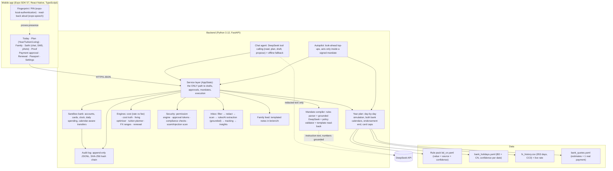
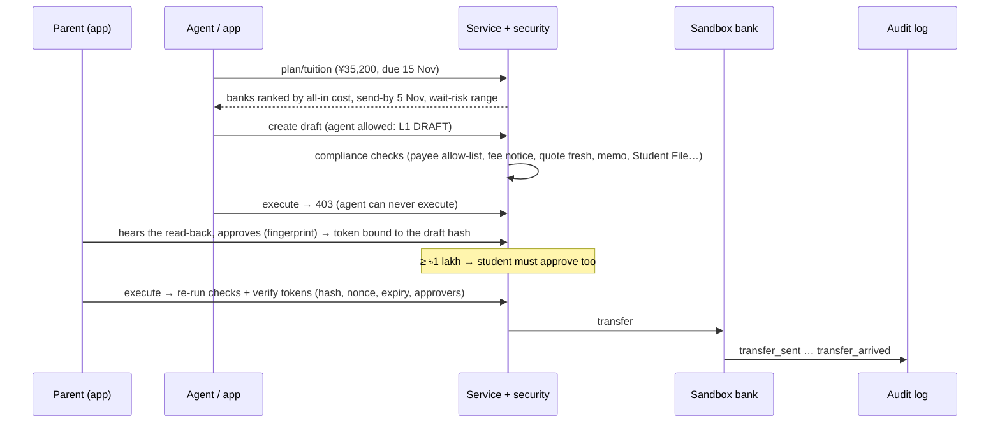

# Sathi: Technical Documentation

**FinTechathon 2026 · International Track · Topic C: Cross-border & Student Finance Assistant**
Repository: https://github.com/Tasrif-Ahmed-Mohsin/finbuddy · Version: 13 Oct 2026 · Companion: [SECURITY_SELF_ASSESSMENT.md](SECURITY_SELF_ASSESSMENT.md)

> **Sandbox:** no real money moves. All payments run in a simulated bank. The **exchange rate is real** (live, plus 953 days of saved daily history). **Bank prices are real or published**:
> - Eastern Bank's own daily CNY rate sheets (`bank_rates.csv`, refreshed automatically).
> - Fees from banks' published 2026 schedules of charges.
> - One real payment (BRAC Bank, ৳18.35/¥).
>
> The few parts that are not published are labelled as assumptions. Every rule, fee and holiday date carries its source and a confidence label.

---

## 1. Summary

**Sathi (সাথী, "companion") keeps an international student funded all year through the legal bank channel, and acts on its own only inside a limit the family has signed.** The hero corridor is **Bangladesh → China**: parent and student both handle money (field interview), the parent pays from Dhaka in Bengali, the student lives in China, and university and bank documents are in Chinese.

**Why this matters.** Money leaving Bangladesh for study can only go through a bank **Student File**: there is no Wise or Remitly for outbound BDT (Wise's own help page says it cannot send from BDT). That legal channel is fragile:

- the student's **card endorsement** is short (Sep → Dec), and **renewing it needs the student in person** at the bank with the passport (field interview), so a student in China loses card access abroad;
- monthly card caps (5 lakh BDT / 30 transactions) apply, and every ATM withdrawal costs ~৳345;
- transfers take ~7 days, Bangladeshi branches close Fri–Sat and for about a week at each Eid, and Chinese banks close for Spring Festival.

When the channel breaks, families are pushed toward hundi, and in China, money from strangers can get the student's account frozen. Sathi's goal: **make the legal way easier than hundi.**

**One loop, not a list of features:**

| Step | What Sathi does | Where |
|---|---|---|
| **Sense** | Money in China and transfers on the way; bank SMS/email (redacted); photographed documents; the real exchange rate | Today tab, Sathi tab |
| **Plan** | The **"never stuck" year plan**: a day-by-day simulation across both countries' bank calendars, the endorsement end and card limits; true cost (rate markup vs fees) | Plan → Year |
| **Act** | The parent writes a **family mandate** in their own words → strict proposal → signed with fingerprint (both people for large caps) → the **autopilot** sends living money inside it and asks for anything else | Family tab |
| **Prove** | A receipt for every payment (who or what authorised it), a hash-chained log, the payment passport | Proof tab |

| Organiser capability | How Sathi shows it |
|---|---|
| **Intent understanding** | Mandates written in Bengali, English or Chinese (rules parser + grounded DeepSeek); chat with tool calling; SMS/email parsing; document photos |
| **Task planning** | Year plan with look-ahead top-ups; living optimiser; tuition send-by planner; renewal plan for a student abroad |
| **Safe execution** | Autopilot only inside a signed mandate (L3); every payment re-checked by deterministic compliance rules; approval tokens bound to the exact draft; sandbox bank; hash-chained log |
| **User control** | Read-back read aloud before signing or approving; signatures bound to the proposal hash; two-person rule from ৳1 lakh; one-tap cancel; the family is asked whenever a limit would be exceeded |
| **Measurable value** | Stuck days: **20 → 0** in the year plan, **0** in a 4-month live sandbox run; overhead **4.39% → 3.88%** with published bank fees; the real payment's fee was **5.5×** its rate markup |

## 2. Problem and evidence (short)

Full research: [01_problem_research.md](01_problem_research.md) (34 problems with sources) plus a field interview with a Bangladeshi student who arrived in China in Sept 2026 (and a follow-up on 13 Oct). Key facts:

- **Fees, not the rate, are the big leak.** The interviewee's real BRAC payment of ¥35,200 at ৳18.35 was only **+0.22%** over the mid-market average for Aug–Sep (৳1,448). The **~৳8,000 charge was 5.5× that**. In the year plan, **70%** of what a family loses today is fees and surcharges, not the exchange rate.
- **The channel breaks on predictable days:** the endorsement ends on 31 Dec and cannot be renewed from China; Bangladeshi banks close Fri–Sat and for Eid; Chinese banks close for Spring Festival. With today's habits the demo student is without money on **20 days** of the year.
- **Both parent and student handle money** (follow-up), in different languages; the university and bank speak Chinese.
- **Scams and informal channels:** hundi was offered to the interviewee; "discount tuition agents"; fake-police calls.

## 3. Architecture



**Why a backend, not "all in the phone":** the permission checks, compliance rules, the autopilot and the audit log must run where neither a tampered app nor the AI can skip them. Every route goes through one service class (`backend/app/service.py`), and every action is logged.

### 3.1 The loop, end to end: family mandate → autopilot

```mermaid
sequenceDiagram
  participant P as Parent (app, Bengali)
  participant St as Student (app)
  participant S as Service + security
  participant A as Autopilot
  participant B as Sandbox bank
  participant L as Audit log
  P->>S: "প্রতি মাসে ১ লাখ ২০ হাজার টাকা পর্যন্ত…" (up to 1.2 lakh a month)
  S->>S: compile: rules parse → DeepSeek (numbers must be in the text) → policy limits
  S-->>P: proposal + template read-back (bn/en/zh) + hash; ≥ ৳1 lakh → both must sign
  P->>S: sign(hash) after fingerprint
  S-->>St: "Needs you: sign the family mandate"
  St->>S: sign(hash) after fingerprint
  S->>L: mandate_created (signers, proposal hash)
  loop every sandbox day
    A->>A: topup_decision(balance, transfers on the way, BD + CN bank days)
    A->>S: draft as AGENT → compliance checks → execute_under_mandate (caps checked)
    S->>B: transfer (leaves next BD bank day, lands next CN bank day)
    B->>L: transfer_sent (level MANDATE) … transfer_arrived
    A-->>P: feed: "Sathi sent ¥5,700 … Why now: banks closed for Eid-ul-Fitr …"
  end
  Note over A,P: cap too small (e.g. early top-up before Spring Festival) → the parent is asked, approves with one tap
```

### 3.2 Request lifecycle: tuition payment (task T1)



### 3.3 Repository map

| Path | Content |
|---|---|
| `backend/app/service.py` | Service layer: plans, drafts, approvals, execution, mandates and proposals, year plan, feed, receipts, simulated time, cards, renewals, passport, documents |
| `backend/app/engines/` | `year_plan.py` (calendar, look-ahead rule, simulation), `cost.py`, `cost_truth.py`, `living_planner.py`, `tuition_planner.py`, `fx_range.py` |
| `backend/app/agent/` | `autopilot.py`, `mandate_compiler.py`, `chat.py` (tool-calling agent + fallback), `llm.py` (DeepSeek client), `explain.py` |
| `backend/app/security/` | `permissions.py` (levels, tokens, mandates), `compliance.py` (checks), `scam.py` (scam/injection patterns) |
| `backend/app/inbox/` | `filters.py`, `redact.py`, `parsers.py`, `extract_llm.py`, `insights.py`, `service.py`, `email_imap.py` |
| `backend/app/` | `notify.py` (family feed, read-backs), `fx.py`, `market.py`, `renewal.py`, `passport.py`, `documents.py`, `sandbox/bank.py`, `audit/log.py` |
| `backend/app/corridors/bd_cn.yaml` | Rule pack: every number with value, confidence (official / secondary / field / assumption) and source |
| `backend/app/data/` | `bank_holidays.yaml` (BD + CN closures), `bank_quotes.yaml` (estimates + real payment), `fx_history.csv`, `demo_messages.yaml` |
| `backend/scripts/` | `fetch_fx_history.py` (data pipeline), `demo_scenario.py` (end-to-end run + evidence export) |
| `backend/tests/` | 203 automated test cases (14 files) |
| `mobile/src/` | Expo Router screens (`app/`), components, API client, i18n (bn/en/zh), formatting (lakh, Bengali digits) |
| `docs/` | Research, plans, this document, security self-assessment, `evidence/` (sandbox operation logs) |

## 4. Core algorithms

### 4.1 Year plan: "never stuck" (`engines/year_plan.py`)
**Question:** over the year, on which days would the student have no way to get money, and which transfer schedule avoids every one of them at the lowest cost?

**Model (day by day, exact and explainable):** the student spends `daily = monthly_living / 30` (¥200 for the demo). New money arrives in two ways:

| Channel | Available when | Cost |
|---|---|---|
| ATM with the Bangladeshi card | only while the card endorsement is valid and the card is active; within per-withdrawal, daily, monthly ATM, 30-transaction and 5-lakh caps | ৳345 + ¥25 per withdrawal + 1% card markup + 3% non-USD factor |
| Transfer (TT) from the Student File to the student's own Chinese account | sent only on a **Bangladeshi bank day** (not Fri/Sat, not BD holidays); lands after 7 days on the next **Chinese bank day**; Student File valid; ≤ USD 2,000/month for living | cheapest bank: rate markup + fixed fee |

A **stuck day** is a day the student cannot cover their spending. The **bank calendar** (`data/bank_holidays.yaml`) lists Bangladesh (Fri–Sat weekend, Victory Day, year-end bank holiday, both Eids, …) and China (Sat–Sun, New Year, Spring Festival, …), each date with a confidence label: fixed-date holidays are `official`; lunar dates (Eid, Spring Festival) are `assumption` until the governments publish them.

**Two strategies, same banks, same rate (no forecast):**
- **today**: a careful family now: ATM while the card works (withdraw when ~2 days are left); once it stops, a transfer when about a week of money is left.
- **sathi**: the look-ahead rule below, the same function the live autopilot uses.

**Result for the demo student (saved real rates, 12 Oct 2026 → 29 Jun 2027):**

| | Today's habits | Sathi |
|---|---|---|
| Days without money | **20** (5 spells: just after the card stops; Spring Festival; Eid-ul-Fitr; a weekend; Eid-ul-Azha) | **0** |
| Fees + markup (published rates and fees) | ৳42,005 (**4.39%**) | ৳38,772 (**3.88%**) |
| Of which fees and surcharges | **89%** | 94% |
| Saved for the same money | | **৳5,126** |

With real published fees (৳3,680 per transfer at EBL), a transfer is fee-heavy and rate-light. Sathi's value is mainly **no stuck days**; the cost saving comes from avoiding ATM fees and card surcharges. Larger, less frequent transfers would cut fees further, but the mandate's per-payment cap is the family's choice.

Each stuck spell lists its reason ("The card stopped working abroad when the endorsement ended on 2026-12-31 (renewing it needs the student at the bank in Bangladesh)"; "Banks were closed for Eid-ul-Fitr, which delayed the transfer").

#### Stress test and "what if" (`engines/stress.py`, `GET /plan/stress`)
**Question:** is "0 stuck days" robust, or one lucky simulation? The plan assumes exact spending, 7-day transfers and the estimated holiday dates. We re-run the same year **200 times** (seeded, reproducible) with real-life mess:

- **spending:** each month 70–130% of the plan, plus 1–4 surprise bills a year (¥300–1,500);
- **transfers:** each one 0–3 days later than planned;
- **holidays:** the estimated (lunar) dates moved by −2…+2 days. The planner still believes the estimates.

The planner never sees the future. It reacts to the real balance and the real **spending pace**, exactly like the live autopilot. Both strategies face the same messy year in each run.

| 200 messy years | Today's habits | Sathi |
|---|---|---|
| Years with no stuck day | **0%** | **64%** |
| Typical year (median) | 30 days | **0 days** |
| Mean / 90th percentile | 30.1 / 40 days | **0.9 / 3 days** |
| Worst year | 52 days | 10 days |

What made it robust (both rules are shared with the live autopilot):
1. **Spending pace** (`spending_pace`): the planner uses the plan, or the last 14 days of spending if the student spends faster (the single biggest day is ignored, so one deposit does not inflate every later transfer).
2. **Late margin** (`transfer_late_margin_days` = 3): waiting is safe only if the money lasts even when the next transfer is 3 days late. The 5-day cushion already covers ordinary delays, so this matters only when a late transfer would run into a Chinese closure. The normal year plan is unchanged (same 10 transfers, same cost).

| Sathi, 200 messy years | Years with none | Median | Mean | 90th pct | Worst |
|---|---|---|---|---|---|
| Plain look-ahead rule | 35.5% | 2 | 2.7 | 8 | 12 |
| + late margin only | 41% | 1 | 1.9 | 5 | 10 |
| + spending pace only | 53% | 0 | 1.4 | 5 | 10 |
| **+ both (shipped)** | **64%** | **0** | **0.9** | **3** | **10** |

**Remaining risk, said plainly:** the worst years have a late transfer running into a moved holiday (e.g. Labour Day) after the card has stopped, so there is no fast cash channel. That is the job of the emergency plan, not of better scheduling.

**What if (single scenarios, same year):**

| Scenario | Stuck days: today → Sathi | Family pays |
|---|---|---|
| The taka weakens 10% | 20 → **0** | +৳1.00 lakh for the year (the same yuan cost more taka) |
| The student spends 30% more | 38 → **0** | +৳3.14 lakh (more money sent; Sathi notices within 1–2 weeks) |
| Every transfer is 3 days late | 23 → **0** | same |
| Eid and Spring Festival fall 2 days later | 20 → **0** | same |
| All of these at once | 45 → **0** (2 cash bridges while the card works) | +৳4.48 lakh |

For the exchange-rate scenario both sides use the banks' markups over the market rate, because a published sheet is a fixed taka number for one day and would hide the move.

### 4.2 The look-ahead top-up rule (`topup_decision`)
Shared by the year plan and the live autopilot, so **what the plan promises is what the agent does**.

On a Bangladeshi bank day `d`, with balance `b` and transfers on the way:

1. `next` = the next Bangladeshi bank day after `d`; `wait_lands` = the Chinese bank day a transfer sent on `next` would land.
2. **Waiting is safe** if, without a new transfer, the money never runs out before `wait_lands` **and** at least `safety_days` (5) of money are left the day before it lands. Then do nothing.
3. Otherwise **send today**. It lands on `lands = arrival(d)`, sized so that after it lands the student has `target + safety` days (30 + 5) of money: `amount = ceil₁₀₀(daily × 35 − max(balance_at_landing, 0))`, at least ¥1,000 (each transfer pays a fixed fee).
4. If the money runs out even before `lands`, the shortfall is a **cash bridge**. Sathi tells the student to withdraw it; it never withdraws cash itself.
5. **Late margin:** the "waiting is safe" check also requires that the money lasts if the transfer sent on `next` arrives 3 days late (`transfer_late_margin_days`). Normally the cushion covers this; near a Chinese closure it makes Sathi send a few days earlier.
6. **Spending pace:** `daily` is the plan, or the student's real pace over the last 14 days if that is faster (`spending_pace`).
7. The decision carries its reason: the closures that make waiting unsafe (e.g. Eid closes BD branches 8–13 Mar, so a transfer sent on 14 Mar would land on 22 Mar), or the day the money drops below the cushion.

Unit tests cover waiting, sending before Eid with the right reason, the bridge, no sending on a bank holiday, the spending pace and the stress hooks.

### 4.3 Family mandate compiler (`agent/mandate_compiler.py`)
The parent's words become a strict rule:

1. **Rules parser (offline, deterministic):**
   - Bengali and full-width digits; `1,20,000`; compound amounts (`১ লাখ ২০ হাজার` = 120,000; `1.2 lakh`; `12万`).
   - "per month / week"; "for N months" (a duration, so not money).
   - Tuition, other payees, or limits written in yuan.
2. **DeepSeek (optional, `json_object`):** reads the same text. **Grounding:** every number it returns must be one the rules parser found in the text, otherwise it is ignored and a note says so. Only the rules may refuse: the model's yes/no flags become a reminder. (With the live model, "my son's account" was flagged as another person; the payee is fixed by policy anyway.)
3. **Policy validator:**
   - The payee is always the student's own verified Chinese account.
   - The mandate covers living money only (`kinds = tt_living`, never tuition).
   - The cap is clamped to Bangladesh's living limit (USD 2,000/month ≈ ৳2,53,000).
   - It lasts at most 12 months and never past the Student File's expiry.
   - "Per month" means a calendar month.
   - A per-payment cap ≥ ৳1 lakh requires **both parent and student** to sign (the two-person rule extended to standing authority).
   - Text with scam or prompt-injection signals is refused.
4. **Read-back** in bn/en/zh from templates (never the LLM). The proposal's **hash** covers exactly the fields shown; a signature must present that hash (what you read is what you sign). The agent may propose, but never sign.

### 4.4 Autopilot (`agent/autopilot.py`)
It runs once per sandbox day, and right after a mandate is signed:

1. **Sense** the money in China and the transfers on the way.
2. **Plan** with `topup_decision`.
3. **Fit** the amount into Bangladesh's monthly living limit and the mandate's per-payment and calendar-month caps (largest ¥100 multiple whose cheapest all-in cost fits).
4. **Act:**
   - Create a draft as the AGENT, so all compliance checks run, then execute it under the mandate at level MANDATE.
   - If it doesn't fit, or a check fails, **ask the family** (one request per month and reason) instead of acting.
5. **Explain** in the family feed in three languages, e.g. "Why now: banks are closed for Eid-ul-Fitr…".

It also warns 14 days before the mandate ends and when the card is about to stop. Reading an SMS never triggers a payment.

### 4.5 All-in cost engine and cost truth (`engines/cost.py`, `engines/cost_truth.py`, `market.py`, `bank_rates.py`)
All money uses `Decimal`. Each line is tagged `mid` (the money itself), `rate` (exchange-rate markup) or `fee` (fixed fees and surcharges), so the app can show **where the money goes**.

**Where bank prices come from.** Each price has two halves, each with its own label:

| Half | Sources, best first |
|---|---|
| Rate | `published`: the bank's own daily sheet · `real_payment` · `user_quote` · `estimate` |
| Fees | the bank's published schedule of charges; otherwise a peer bank's schedule, labelled `assumption` |

There are no unnamed estimates any more. A bank whose fees are not published at all is not priced.

**Rates: `bank_rates.py`, `scripts/fetch_bank_rates.py`.**
- Eastern Bank (EBL) publishes a daily PDF rate sheet with a CNY row. The fetcher downloads the sheets (incremental, one request at a time) and parses the CNY TT/OD selling rate and EBL's own mid-rate. Two date layouts are supported.
- Each row is sanity-checked: buying < mid < selling, spread < 5%. A changed layout is **rejected, not guessed**.
- Downloaded PDFs are untrusted: magic bytes, ≤ 2 MB, ≤ 5 pages, parsed in memory.
- In `live` mode the server also tries today's sheet, at most once an hour, with a 4-second timeout, and falls back to the saved file.
- If the market rate and the sheet are from the same days (±3), the published rate is used as is. Otherwise (an old sheet, or the test fixture) the bank's own published markup over its mid-rate is applied to today's market rate.

**Fees: `data/bank_fees.yaml`**, read from the original PDFs on 13 Oct 2026:
- **Per transfer:** commission by the BDT value sent (৳100 / 200 / 300 / 500 up to ৳1 lakh / ৳5 lakh / ৳10 lakh / above; identical at EBL and Southeast Bank), plus correspondent bank ৳2,500 and SWIFT ৳500, plus 15% VAT on all fees. Example: a ৳1,13,000 transfer pays **৳3,680** in fees at EBL.
- **Student File:** opening and yearly renewal fees per bank, incl. VAT: EBL ৳8,625 / ৳7,475; Southeast ৳8,050 / ৳4,025; Prime ৳6,900 / ৳6,900. These are shown as a comparison table, not added to each transfer.

**Formulas:**
- TT: `total = (X + intermediary) × bank_rate + fees(principal)`, with `fees = (commission(principal) + correspondent + SWIFT) × 1.15`
- ATM withdrawal i: `(wᵢ + CN_fee) × mid × (1+card_markup) × (1+non_USD_factor) + BD_fee`
- Alipay with a foreign card: 3% above ¥200.

**Cost truth** recomputes the real payment from saved market data: ¥35,200 at ৳18.35 vs a mid-market average of ৳18.31 (15 Aug–30 Sep; the exact day is unknown):

| Item | Amount |
|---|---|
| Rate markup | **৳1,448 (0.22%)** |
| Fixed charge | **৳8,000** |
| Charge vs markup | **5.5×** |
| Eastern Bank's published rate, same weeks | ৳18.49 average over 30 sheets (৳18.33–18.55): BRAC's ৳18.35 was 0.74% below that average |
| Paid in total | ৳6,53,920 |

The ৳8,000 matches the banks' published one-time **Student File opening fees** (৳6,900–৳8,625 incl. VAT), so it was most likely not a per-transfer charge (to confirm with the interviewee).

**Rate watch: does timing the bank pay? (`engines/rate_watch.py`, in `GET /market/prices`, card in Plan → Tuition).** Families ask "should we wait for a better rate?". We answer from Eastern Bank's 138 published sheets (Mar–Oct 2026) against the market rate on the same days:
- markup over the market: median **0.97%**, middle half 0.86–1.09%, range 0.28–1.52%; the latest sheet is labelled low / usual / high against that history;
- backtest of the usual rule, "today looks expensive (top-quarter markup), so wait up to 3 sheets and take the cheapest": in 35 cases it lowered the taka price 20 times, by **0.02% on average (৳21 per ৳1 lakh)**. One ৳1 lakh transfer pays **৳3,565** in fees.

The markup swings are mostly the market moving under a smooth bank price (day-to-day correlation of the markup: 0.09), not the bank being expensive. So Sathi does **not** time the market: it avoids extra transfers (fees) and days without money. This is shown to families as a finding, not hidden.

### 4.6 Living-money constrained optimiser (`engines/living_planner.py`)
Exact grid search over the transfer amount `t` (¥100 steps). The rest is split into ATM withdrawals of maximum size, in whole ¥100 notes, to minimise fixed fees.

Every option must stay within:
- 30 card transactions and 5 lakh BDT a month;
- the per-withdrawal, daily and monthly ATM caps;
- the USD 2,000/month living-remittance cap;
- a cash bridge for the days before a transfer can arrive.

Every rejected option records which limit it breaks. A property-style test checks 30 input combinations: the chosen plan **never breaks a limit**. Result on real rates and published fees: ¥6,000 a month saves ৳3,001 compared with ATM only.

### 4.7 Tuition planner (`engines/tuition_planner.py`)
- **Send-by date** = deadline − transfer days (7) − buffer (3). Chinese universities count a fee as paid on arrival.
- **Banks** are ranked by all-in cost for the exact amount.
- **Wait-risk** is the cost range if the family waits until the send-by date (§4.8), labelled honestly: waiting has no expected gain under a random walk.

### 4.8 FX ranges with an honesty check (`engines/fx_range.py`, `fx.py`)
No direction is predicted (Meese & Rogoff 1983). The ranges are the empirical 10th/50th/90th percentiles of past `h`-day log returns (rolling 250-day window).

**Backtest on 953 real days:** 7-day 80% ranges were right **81.9%** of 689 tests, 14-day 85.8%, 30-day 86.8%.

**Data pipeline:** `scripts/fetch_fx_history.py` (fawazahmed0/exchange-api, CC0). The live mode falls back to the saved history when offline.

### 4.9 Message tracking pipeline and insights (`inbox/`)
`filter → redact (OTP removed, numbers masked) → scam/injection scan → rules extraction → DeepSeek fallback on redacted text with number grounding → card-limit tracking → deterministic insights`

The insights cover:
- ATM-fee leakage;
- card limit ≥ 80%;
- a large debit ("was this you?" plus freeze);
- a duplicate charge, or a charge on a frozen card;
- phishing and scam messages;
- an OTP received;
- renewal steps;
- a hidden FX markup.

### 4.10 Chat agent (`agent/chat.py`)
**Setup:** DeepSeek `deepseek-flash`, thinking mode disabled, at most 4 tool rounds.

**Tools:**
- `get_overview`, `get_updates`, `list_transactions`
- `compare_tuition`, `plan_living`, **`get_year_plan`**
- `check_message`, `start_renewal`, `freeze_card`
- **`propose_mandate`**, `create_payment_draft`

There is **no tool to approve, execute, sign, unfreeze or change a mandate**, and every tool runs as `Actor.AGENT` through the permission engine.

**Offline fallback:** a deterministic router in BN/EN/ZH. It recognises standing instructions in taka, year-plan questions, scams, a lost card, renewals, tuition and living money.

### 4.11 Renewal planner (`renewal.py`)
- **Student File:** scheduled backwards from the expiry (bank visit, documents to the parent, university request), with an email to the international office in EN + ZH and a task list for the parent in BN + EN.
- **Card endorsement for a student in China** (renewal needs the student in person):
  1. check the Chinese account can receive money;
  2. **switch living money to transfers** before the card stops (the parent signs the mandate, due expiry − 12 days);
  3. renew on the next visit home;
  4. confirm the new expiry.
- The Bengali parent message explains why.

### 4.12 Payment passport and document reader
- **Passport:** HMAC-signed record of on-time payments, built from this session's audit entries. Late payments are shown as late. It can be revoked, expires after 90 days, and has a public QR page that needs a verification code. It is not an official credit score.
- **Document reader:** DeepSeek vision reads fee notices, Chinese forms and checklists. Amounts are kept only if they appear in the transcription. The image is never stored. A fee notice is applied only after the user confirms.

## 5. Security design (summary)

Full details, the permission-tier implementation and the known-risk list are in **[SECURITY_SELF_ASSESSMENT.md](SECURITY_SELF_ASSESSMENT.md)**.

- **Permission levels:**
  - L0 Read, L1 Draft (the agent proposes mandates here).
  - L2 Execute: needs a user approval token.
  - L3 Mandate: the autopilot works only inside a signed, capped, revocable mandate that covers living money only.
  - Hard blocks that nobody can override.
- **Signatures and approvals are bound to what people saw:**
  - proposal hash for mandates;
  - draft hash for payments;
  - the read-back is generated from those exact fields and can be heard aloud.
- **Two-person rule:** payments ≥ ৳1 lakh, and mandates whose per-payment cap is ≥ ৳1 lakh.
- **Asymmetric friction:** the agent may freeze a card and propose; it may not unfreeze, approve, sign or widen a limit. Either person can cancel a mandate in one tap.
- **Integrity and AI containment:**
  - a hash-chained audit log for every action;
  - grounded numbers everywhere the AI reads text;
  - rule-based fallbacks when the AI is unavailable.

## 6. Data, sources and licences

| Data | Source | Confidence / licence |
|---|---|---|
| Mid-market BDT/CNY (live + 953 days) | fawazahmed0/exchange-api | CC0-1.0 (public domain) |
| Bank rates | `bank_rates.csv`: **Eastern Bank's published daily CNY sheets** (fetched by `scripts/fetch_bank_rates.py`) + **1 real BRAC payment** (৳18.35/¥) | published (indicative) / field |
| Bank fees | `bank_fees.yaml`: EBL Retail + SME schedules (1 Jul 2026), Southeast Bank (1 Jan 2026), Prime Bank (Jul–Dec 2026) | official / secondary; BRAC fees = assumption (schedule not found) |
| Rules and limits | `corridors/bd_cn.yaml`, 34 parameters, each with source | official / secondary / field / assumption |
| Bank holidays | `data/bank_holidays.yaml`, BD + CN, Oct 2026 – Sep 2027 | official (fixed dates) / secondary / assumption (lunar dates) |
| Demo messages | `data/demo_messages.yaml` | **synthetic**, written by us |
| Research | `docs/01_problem_research.md` | sources cited per item |

**Software licences** (all permissive): FastAPI, Pydantic, PyYAML, pytest (MIT); Uvicorn, NumPy, httpx, qrcode, pypdf (BSD); Expo, React Native, react-native-svg and Expo modules incl. expo-speech (MIT). Bank rate sheets and schedules of charges are public documents published by the banks; we store only the numbers we use, with their source address.

## 7. Measurable value

| Metric | Value | How measured |
|---|---|---|
| Days without money (year) | **20 → 0** | year plan, same banks and rate (§4.1) |
| Days without money (stress test) | **0** in the typical year, **0.9** mean, **64%** of 200 messy years with none (today's habits: 30 typical, 0% with none) | stress test (§4.1) |
| What if | 0 stuck days with the taka 10% weaker, 30% more spending, every transfer 3 days late, holidays moved, or all at once | stress test (§4.1) |
| Days without money (live) | **0** over 12 Oct 2026 → 21 Feb 2027, through the card stop and Spring Festival | `demo_scenario.py` in the live sandbox |
| Overhead for the year | **4.39% → 3.88%** (৳5,126 saved for the same money), with published fees | year plan |
| Where money is lost | fees are **89%** of today's loss; the real payment's charge was **5.5×** its rate markup | cost truth (§4.5) |
| Timing the bank | waiting up to 3 sheets after an "expensive" day saved **0.02%** (৳21 per lakh) on average, vs ৳3,565 fees per transfer | rate watch backtest, 35 cases |
| Bank rate markup (published) | Eastern Bank's CNY TT selling averaged **+0.96%** over the market (median 0.97%, range 0.28–1.52%, 138 days) | 139 published sheets |
| Living money ¥6,000/month | ৳3,001 saved per month vs ATM-only | optimiser |
| Limits | 0 breaches in 30 tested combinations; autopilot never above a mandate or the living cap (tested) | automated tests |
| FX honesty | 7-day 80% ranges right **81.9%** of 689 tests | coverage backtest |
| Safety | every red-team case blocked (security report §9) | automated tests |
| Languages | Mandates, feed, read-backs and UI in BN/EN/ZH | tests |

## 8. API overview (FastAPI; interactive docs at `/docs`)

| Area | Endpoints |
|---|---|
| **Loop** | `GET /plan/year`, `GET /plan/stress?runs=`, `GET /runway`, `GET /feed?lang=`, `GET /receipts`, `POST /sandbox/advance` (day by day, autopilot runs) |
| **Family mandate** | `POST /mandates/proposals`, `GET /mandates/proposals/{id}`, `POST /mandates/proposals/{id}/sign` (`proposal_hash`), `GET /mandates`, `DELETE /mandates/{id}` |
| Rates and plans | `GET /market`, `POST /market/quotes`, `GET /fx`, `GET /fx/history`, `POST /plan/tuition`, `POST /plan/living` |
| Drafts and execution | `POST /drafts`, `GET /drafts[/{id}]`, `POST /drafts/{id}/approve`, `POST /drafts/{id}/execute`, `POST /drafts/{id}/execute-under-mandate/{m}`, `POST /mandates` (raw, parent only) |
| Agent | `POST /agent/chat`, `GET /agent/status`, `POST /check/message` |
| Inbox | `POST /inbox/messages`, `POST /inbox/webhook`, `POST /inbox/email/sync`, `POST /inbox/demo/seed`, `GET /inbox/*`, `GET /insights?lang=` |
| Cards, renewals, documents, passport | `/cards/*`, `/renewals/*`, `/documents/*`, `/passport/*` |
| Overview | `GET /timeline`, `GET /profile`, `GET /accounts`, `GET /corridor`, `GET /audit`, `GET /audit/export`, `GET /health` |

Authentication in the sandbox: `Authorization: Bearer demo-student | demo-parent | demo-agent` (a known risk; see the security report).

## 9. Deployment and running

```bash
# Backend (Python 3.12)
cd backend && python -m venv .venv && .venv/Scripts/python -m pip install -r requirements.txt
.venv/Scripts/python -m uvicorn app.main:app --host 0.0.0.0 --port 8000
# Mobile (Node 22): scan the QR code with Expo Go, or use --web
cd mobile && npm install && npx expo start
```

| Variable (`backend/.env`, git-ignored) | Purpose |
|---|---|
| `DEEPSEEK_API_KEY` | chat agent, mandate reading, extraction fallback, translation, document reader (optional: rules work without it) |
| `DEEPSEEK_MODEL` | default `deepseek-flash` |
| `SATHI_FX_MODE` | `live` (default) · `offline` (saved history) · `fixture` (tests) |
| `SATHI_INGEST_TOKEN` | webhook secret for SMS forwarders |
| `SATHI_PASSPORT_SECRET` | passport signing key (random per process if unset) |
| `SATHI_IMAP_HOST / _USER / _PASSWORD` | optional read-only bank-alert mailbox (app password) |
| `EXPO_PUBLIC_API_URL` (mobile) | backend address for a deployed server |

**Final-day network plan (Shenzhen):** DeepSeek is reachable from mainland China. If the network fails anyway, FX switches to the saved history, mandates compile with the rules parser and the agent uses its rule-based fallback, so every task still completes.

## 10. Testing and execution evidence

- `cd backend && .venv/Scripts/python -m pytest -q` runs **203 test cases** (156 test functions, some parameterised), all passing:

  | Area | Test cases |
  |---|---|
  | Living optimiser (incl. 30-combination limit check) | 36 |
  | **Bank prices: published sheets, fee schedules, labels** | **21** |
  | **Family mandate, signatures and autopilot** | **26** |
  | Security and permissions | 20 |
  | Inbox and privacy | 17 |
  | FX and card controls | 16 |
  | End-to-end API scenarios | 13 |
  | **Year plan, bank calendar, cost truth** | **12** |
  | Payment passport | 10 |
  | Renewals (incl. endorsement from abroad) | 10 |
  | Agent | 9 |
  | Documents | 5 |
  | Tuition and FX method | 5 |
  | Cost engine | 4 |

  Tests never call the real AI (a fake DeepSeek server is used) or the network.
- `cd mobile && npx tsc --noEmit && npx expo lint`: clean.
- **Execution evidence:** `python scripts/demo_scenario.py` runs the whole loop through the real API, one sandbox day at a time, from 12 Oct 2026 to 21 Feb 2027:
  1. Sense: SMS and money in China.
  2. Plan: year plan and cost truth.
  3. Act:
     - Bengali mandate; wrong-hash and agent signatures refused; both sign.
     - An injected instruction is refused.
     - A scam payment is blocked.
     - Tuition paid with two approvals.
     - Card frozen and unfrozen.
     - Renewal planned from abroad.
     - The card stops; Spring Festival.
  4. Prove: feed, receipts, passport.

  **Result: 0 stuck days**, 4 autopilot payments inside the mandate, and 1 family approval when the cap wasn't enough (an early top-up before Spring Festival). It exports `docs/evidence/sandbox_operation_log.jsonl` (187 entries, hash chain valid) and `scenario_summary.md`.

## 11. Limitations and next steps

- **Sandbox only.** Real execution would go through licensed banks: the autopilot would submit Student File transfer requests via a bank API, or prepare a branch-ready request.
- **Bank prices:** one bank publishes daily CNY rates that we can read (EBL). The sheets are "indicative", and BRAC's schedule of charges was not found online (its fees are an assumption). Next:
  - read more banks' sheets;
  - ask the banks for the "at actual cost" correspondent and SWIFT charges;
  - collect real debit advices from students;
  - anonymous, consented "true-cost" contributions from students' parsed bank alerts, shown only when at least k students have contributed.
- **Lunar holiday dates are estimates** until the governments publish them. China's make-up working Saturdays are not modelled.
- **Spending in the live sandbox is constant** (¥200/day); the planner already follows a faster real pace (`spending_pace`), and the stress test varies spending, delays and holiday dates. In production the pace would come from the student's parsed bank alerts.
- **Stress-test ranges are assumptions** (70–130% spending, 0–3 days late, ±2 days for lunar holidays), chosen to be pessimistic; they are not measured from data yet.
- **On-chain anchoring is not used yet.** The hash chain is ready: anchoring daily chain heads on a permissioned chain such as FISCO BCOS would let a bank verify the receipts without trusting our server.
- **Production hardening** (real authentication, device-bound keys, KMS, TLS, rate limits): see the security report.
